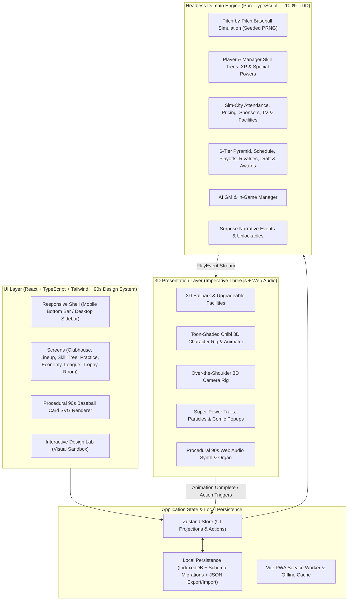

# Mini Baseball Manager — Master Plan & Progress Tracker

> **Living Document**: This file is both our master design/architecture plan and our live progress tracker. Check off items as slices pass their **TDD** and **Visual Verification** gates, and log any pivots or new ideas in the [Plan Adjustment & Decision Log](#plan-adjustment--decision-log) at the bottom.

## Status Legend

- `[ ]` **Planned** — Not started
- `[/]` **In Progress** — Actively being built
- `[x]` **Done** — Implemented, TDD tests passing, and visually verified
- `[~]` **Adjusted / Deferred** — Rescoped or moved (see Decision Log)

---

## Progress Dashboard

| Milestone | Focus | Slices | Status | Target Gate |
| :--- | :--- | :---: | :--- | :--- |
| **M0** | Project Scaffolding, TDD Harness & Android PWA Shell | 4 / 4 | `[x]` Done | CI/TDD green + PWA manifest valid |
| **M1** | **Design-First Visual Identity & Interactive Design Lab** | 6 / 6 | `[/]` Visual Review | **Visual Review Checkpoint** (cards, chibi 3D, animations, camera, SFX) |
| **M2** | **Core Playable MVP** (Sim Engine + Lineups + Live 3D + Local Save) | 0 / 5 | `[ ]` Planned | **Playable MVP Release** (desktop + Android PWA) |
| **M3** | RPG Depth: Real Skill Trees, Special Powers, Practice & Manager Tree | 0 / 3 | `[ ]` Planned | Full player & manager RPG progression live |
| **M4** | GM Operations, 6-Tier League Pyramid, AI Clubs & Team Rivalries | 0 / 4 | `[ ]` Planned | Multi-season promotion/relegation career + rivalries |
| **M5** | Sim-City Economy, Fanbase Engine & 3D Stadium Builder | 0 / 3 | `[ ]` Planned | Attendance, pricing, sponsors, TV & visual stadium upgrades |
| **M6** | Surprises, Awards, Trophy Room, Unlockables & PWA Polish | 0 / 4 | `[ ]` Planned | Long-term replayability & 60 FPS mobile polish |

**Overall Progress**: `10 / 29` feature slices completed *(Milestone 1 ready for visual approval)*

---

## Vision & Core Pillars

Build **Mini Baseball Manager**, an installable cross-platform web game (mobile Android PWA & desktop) where you serve as both **General Manager and Field Manager** of a baseball club climbing from **Rookie Sandlot League** to the **Mini Major League**.

Designed to feel fun and rewarding in **5-minute, 15-minute, 30-minute, or 60-minute sessions**, combining:

1. **90s Cartoon Baseball Card & Toon-Shaded Chibi 3D Visuals (Design-First)**: Expressive miniature *Power Pros*-inspired cel-shaded 3D characters with comic ink outlines competing in a vibrant 3D ballpark viewed in **over-the-shoulder 3D**, paired with procedural **retro 90s baseball-card portraits** and built-in **Web Audio 90s synth SFX & ballpark organ**.
2. **Deep RPG Progression & Real Skill Trees**: Branching skill trees for players (unlocking flashy on-field **Special Powers** like *Blazing Comet Fastball*, *Ghost Knuckle*, *Moonshot Bomb-Swing*, *Ninja Bunt*, *Cannon Power-Arm*, and *Sky-High Leap*) and for the human **Manager** (active in-game powers + permanent team/economy passives), fueled by animated practice drills and live games.
3. **GM Strategy, 6-Tier Promotion/Relegation & Dynamic Rivalries**: Draft, scout, sign, cut, train, and set lineups across 6 tiers (**Rookie → Low-A → High-A → AA → AAA → Major League**), 8 teams per league, 21-game seasons + 4-team playoffs, competing against personality-driven AI GMs and organic **Team Rivalries**.
4. **Sim-City Club Economy, Surprises & Trophies**: Dynamic fanbase & attendance driven by winning, star popularity, and rivalries; ticket & concession pricing; TV contracts; 90s parody sponsors (shown as billboards on your 3D outfield wall); visual 3D stadium & facility upgrades; narrative surprise events; awards; and a Trophy Room.

### Locked-In Technical & Creative Decisions

| Area | Decision |
| :--- | :--- |
| **3D Field Style** | Toon-shaded Chibi 3D (*Power Pros* meets 90s cartoon) with cel-shading & ink outlines + 2D retro 90s baseball-card portraits in UI |
| **UI Aesthetic** | 90s Saturday-Morning Cartoon & Baseball Card (sunny turf greens, cream cardstock, thick comic outlines, chunky tactile buttons, bold team colors) |
| **Tech Stack** | Vite + React + TypeScript + Tailwind CSS v4 + imperative Three.js engine + Zustand + Vitest + React Testing Library + Playwright + `vite-plugin-pwa` |
| **League Format** | 6 tiers × 8 teams (48 clubs); 21-game regular season (3× round-robin vs 7 rivals) + 4-team playoffs (Semis & Finals Best-of-3); Champion promotes up, 8th place relegates down |
| **Audio & Juice** | Built-in procedural 90s Web Audio synth SFX + ballpark organ with global mute/volume toggle |
| **Persistence** | Local-only (IndexedDB primary + localStorage metadata + schema migrations + 3 save slots + JSON Export/Import backup) |
| **Development Process** | Design-First (strong visuals before full loops) + Strict TDD (Red → Green → Refactor) |
| **Mobile Ergonomics** | Android-installable PWA; portrait-first across all screens with automatic wide landscape layout during 3D games |

---

## Architecture Blueprint

### Clean Layered Architecture

Core simulation, RPG progression, AI, rivalries, and economy live in `src/engine/` as **pure TypeScript** with zero React/Three.js/DOM dependencies — enabling fast, deterministic, 100%-TDD-covered logic.



### Target Project Structure

```text
mini-baseball-manager/
├── PLAN.md                       # Master plan & living progress tracker (this file)
├── docs/
│   └── DESIGN_SYSTEM.md          # Detailed color tokens, typography, portrait traits & 3D proportions
├── public/
│   └── icons/                    # Android PWA adaptive & maskable icons
├── src/
│   ├── engine/                   # Pure TS domain engine (ZERO React/Three imports, 100% TDD)
│   │   ├── rng/                  # Seeded PRNG (Mulberry32)
│   │   ├── models/               # Player, Team, SkillTree, Manager, Economy, League, Rivalry, Save
│   │   ├── simulation/           # Pitch/at-bat/game engine + PlayEvent emitter
│   │   ├── rpg/                  # XP, leveling, branching skill trees, special powers, practice drills
│   │   ├── manager/              # Manager XP, skill tree, active/passive powers
│   │   ├── economy/              # Attendance, ticket/concession pricing, TV, sponsors, upgrades
│   │   ├── league/               # 6-tier pyramid, 21-game scheduler, standings, playoffs, rivalries, awards
│   │   ├── gm/                   # Draft generator, scouting, free agency, contracts, cut/sign
│   │   ├── ai/                   # AI GM & in-game AI manager
│   │   └── events/               # Surprise narrative events & unlockables catalog
│   ├── art/
│   │   ├── portraits/            # Procedural 90s cartoon SVG portrait generator & trait parts
│   │   └── themes/               # 90s team palettes, jersey patterns, card foil styles
│   ├── scene/                    # Imperative Three.js 3D engine (unit-testable state & math)
│   │   ├── core/                 # Renderer, resize/DPR manager, mobile perf budget
│   │   ├── characters/           # Chibi 3D mesh builder, dynamic face canvas, toon outline, animator
│   │   ├── ballpark/             # 3D stadium, dirt diamond, stands, fans, upgradeable props & billboards
│   │   ├── camera/               # Over-the-shoulder 3D rig & ball-tracking broadcast camera
│   │   ├── vfx/                  # Pitch trails, bat smears, dust puffs, comic callout sprites
│   │   └── playback/             # PlayEvent -> 3D choreography timeline controller
│   ├── audio/                    # Procedural Web Audio 90s synth SFX & ballpark organ
│   ├── store/                    # Zustand store & local IndexedDB + JSON backup persistence
│   ├── ui/
│   │   ├── design-system/        # Chunky 90s Buttons, Cards, Scoreboard, Badges, Tabs, Modals
│   │   ├── components/           # FlipBaseballCard, SkillTreeGraph, BallparkCanvas, LineupBoard
│   │   └── screens/              # DesignLab, Clubhouse, GameDay, Roster, Practice, Economy, League, Trophies
│   ├── App.tsx
│   └── main.tsx
└── tests/
    ├── e2e/                      # Playwright mobile (Android) & desktop E2E specs
    └── setup.ts                  # Vitest + Testing Library setup
```

---

## Visual & Audio Design Spec

### 90s Baseball Card Palette & Typography
- **Cardstock Cream**: `#FBF4E4` (primary cards) & `#F1E4C8` (secondary panels)
- **Comic Ink Black**: `#181B2C` (`2.5px`–`3px` borders + hard offset shadow `3px 3px 0 #181B2C`)
- **Ballpark Turf Green**: `#2FB356` (mowed stripes `#279E4B`) & **Clay Infield Dirt**: `#D98A4E`
- **90s Sky Blue**: `#4CC3FF` & **Scoreboard Forest**: `#1B4332` with LED Amber `#FFD166`
- **Power-Up Pop Accents**: Electric Coral `#FF4D6D`, Star Gold `#FFC300`, Hyper Cyan `#00E5FF`, Mystic Violet `#9B5DE5`
- **Offline Bundled Fonts**: Athletic/comic display (`@fontsource/bungee` / `@fontsource/fredoka`), readable UI body (`@fontsource/nunito`), tabular scoreboard numerals (`@fontsource/jetbrains-mono`).

### Procedural 90s Cartoon Portraits & Flip Cards
- Deterministic `AppearanceSeed` generating layered SVG portraits: 6 head shapes, 8 skin tones, 14 retro 90s hairstyles, team-colored caps (forward/backwards/visor), 10 eye styles, 8 expressions (grin, bubblegum, smirk, fired-up), and 12 flair accessories (90s shades, eye black, bandage, freckles, handlebar mustache, star earrings).
- Collectible **3D Flip Baseball Card**: Front shows portrait, team banner, jersey #, OVR badge, rarity frame (*Rookie Paper* / *All-Star Chrome* / *MVP Holographic Foil*), and Special Power icons; back shows stat bars, season stats, bio, and quirk blurb.

### Toon-Shaded Chibi 3D Mini Characters
- *Power Pros*-inspired miniature silhouette: oversized expressive head (~45% height), rounded jersey torso with number decal, buoyant stubby hands & cleated feet, oversized cap & bat/glove.
- Cel-shaded `THREE.MeshToonMaterial` (3-step gradient map) + inverted-hull black comic outline + dark ground blob shadow + live offscreen `<canvas>` facial texture (blinking, squinting, cheering, rivalry glare!).
- Appealing squash-and-stretch animations: `idle`, `pitch_windup`, `pitch_super`, `bat_stance`, `bat_swing`, `bat_bunt`, `bat_bomb`, `field_ready`, `field_run`, `field_dive`, `field_high_jump`, `field_throw`, `practice_cage`, `practice_bullpen`, `practice_fungo`, `practice_sprint`, `celebrate_hr`, `team_huddle`.

### Over-the-Shoulder 3D Camera & VFX
- Behind-pitcher and behind-batter over-the-shoulder 3D camera angles + smooth spring-damped broadcast ball-tracking follow cam.
- Comic-book VFX: flaming fastball comet trail, zig-zag purple ghost knuckleball, rainbow moonshot HR ribbon, dust puffs, and floating comic captions (`"CRACK!"`, `"WHOOSH!"`, `"ZING!"`, `"ROBBED!"`, `"KA-BOOM!"`).

### Procedural Web Audio 90s Synth & Organ
- Zero-dependency Web Audio API engine: bat crack, glove pop, super-pitch whoosh, spring boing, crowd cheer swell, cash chime, level-up fanfare, and ballpark organ riffs (*Charge!*, rally riff, HR jingle, rivalry sting) with global mute & volume control.

---

## Core Game Systems Reference

### 1. Player RPG & Branching Skill Trees
- **Core Stats (1–99, displayed with F–S+ grades)**: Batting (Contact, Power, Eye, Bunt), Pitching (Velocity, Break, Control, Stamina), Athleticism (Speed, Fielding, Arm), Intangibles (Clutch, Popularity, Potential).
- **Branching Trees**: Interactive node-graph trees for **Pitcher**, **Batter**, and **Fielder** with prerequisites and capstone **Special Powers** (2 active slots, 3 at Legend tier) powered by an in-game Hype/Energy Gauge:
  - *Pitchers*: **Blazing Comet Fastball**, **Ghost Knuckle**, **Tornado Slider**, **Rubber Arm**, **Ice Veins**.
  - *Hitters*: **Moonshot Bomb-Swing**, **Ninja Bunt-Specialist**, **Laser Gap-Seeker**, **Rally Spark**, **Two-Strike Magnet**.
  - *Fielders*: **Cannon Power-Arm**, **Sky-High Leap**, **Vacuum Glove**, **Turbo Cleats**.
- **Global Nationalities & Cultural Heritage Abilities (Myths & Animals)**:
  - Weighted player generation (**50% USA**, **5% each**: Canada, Japan, Korea, Mexico, Dominican Republic, Puerto Rico, Brazil, Argentina, Australia, Ireland — cleanly extensible for more nations!).
  - Every player celebrates their heritage with a crisp SVG flag badge, authentic name/hometown pool, and a signature unlockable **Cultural Heritage Ability**: *Eagle Soar* (USA), *Moose Charge* (CAN), *Kitsune Mirage* (JPN), *White Tiger Pounce* (KOR), *Serpent Wind / Quetzalcoatl* (MEX), *Huracán Swing* (DOM), *Coquí Leap* (PRI), *Jaguar Dash* (BRA), *Condor Glide* (ARG), *Kangaroo Bounce* (AUS), and *Leprechaun's Luck* (IRL).
- **Hot Streaks & Cold Slumps (Dynamic Player Form)**:
  - Rolling performance momentum across recent games puts players into **Hot Streaks** (*🔥 On Fire!* — temporary contact/power/velocity surge, fiery card backdrop, glowing chibi sparks, bonus fan hype & faster Special Power charge) or **Cold Slumps** (*🧊 Cold Spell* — temporary batting/control dip, sweaty/nervous portrait mood).
  - Managers can actively bust slumps via targeted **Practice Drills**, **Active Manager Pep Talks**, dropping them in the lineup for low-pressure at-bats, or narrative **Surprise Events**.
- **Lefty / Righty / Switch Handedness & Platoon Strategy**:
  - Realistic generation distributions: **Batting** (`50% R`, `40% L`, `10% Switch`), **Throwing** (`SP`: 35% L / 65% R; `RP`: 50% L / 50% R; `LF/CF/RF`: 50% L / 50% R; `1B`: 80% L / 20% R; `C`: 20% L / 80% R; `2B/3B/SS`: 100% R).
  - **Platoon Matchups**: Same-hand matchups (`LHP vs LHB`, `RHP vs RHB`) grant the pitcher extra breaking-ball deception & K rate; opposite-hand matchups grant the batter cleaner sightlines & Contact/Power boosts; **Switch Hitters (`S`)** always bat from the opposite box to claim the platoon edge.
  - **Handedness Traits**: Lefty batters get a subtle first-base step bonus on grounders/bunts; Lefty pitchers get a hold-runners/pickoff bonus; Lefty `1B` get a stretch/scoop defensive edge. Reflected visually on all cards (`B/T`), 2.5D chibi gloves/bats/helmet ear-flaps, and 3D batter's box placement!

### 2. Human Manager RPG Powers
- **Skipper Path (Active In-Game Powers, 1–3 uses/game)**: *Fired-Up Pep Talk*, *Mound Whisper*, *Clutch Focus*, *Rally Cap Magic*.
- **Coach Path (Permanent Training Passives)**: *Cage Whisperer* (+20% batting XP), *Pitching Lab* (+20% pitching XP), *Breakthrough Mentor* (double-SP crits), *Iron Conditioning*.
- **Mogul Path (Permanent Economy/GM Passives)**: *Fan Favorite Promotions*, *Silver Tongue*, *Eagle-Eye Scouting*, *Sponsor Magnet*.

### 3. 6-Tier Pyramid, 21-Game Seasons & AI Opponents
- **Tiers** (8 teams each = 48 unique clubs): 1. Rookie Sandlot → 2. Low-A Backyard → 3. High-A Bus → 4. AA Diamond → 5. AAA Stardom → 6. Mini Major League.
- **Season Loop**: 21 regular-season games (7 three-game series, 3× round-robin) → 4-team Playoffs (Best-of-3 Semis & Finals) → Promotion (Champion moves up) & Relegation (8th place moves down) → Awards Ceremony, Contracts, 3-Round Draft, Free Agency.
- **Session Pacing**: Live 3D (1x / 2x / 4x), **Clutch Moments ("Key Moments")** auto-simming routine innings and zooming into 3D for RISP/late innings/rivalries/super-powers, and **Instant Sim**.

### 4. Dynamic Team Rivalries
- **Rivalry Heat Meter (0–100)** per club: *Neutral (0–24)* → *Sparks Flying (25–49)* → *Bitter Rivals (50–79)* → *Arch-Nemesis (80–100)* — persists across seasons and promotion/relegation!
- **Triggers**: Starting Crosstown Rival in Rookie League + organic escalation from 1-run thrillers, walk-offs, playoff rematches, mascot pranks, and **Free-Agent Poaching** (*Ex-Star Revenge Matchups*).
- **Stakes & Spectacle**: Pre-game **90s Comic "VS" Title Card**, heated 3D facial glare, rival fans in the stands, **+25–50% Special Power Hype charge**, **+25% Bonus XP**, **+25–50% Home Attendance Sellout Surge**, bonus sponsor payouts, and a **Traveling Rivalry Cup** displayed in your Trophy Room!

### 5. Sim-City Club Economy & Stadium Builder
- **Revenue**: Dynamic Attendance × Ticket Price, Concessions (Hot Dogs, Nachos, Foam Fingers, Ice Cream Helmets with pricing & quality), Star Player Merch, 90s Parody Sponsors (*Turbo Fizz*, *Rad Shades*, *Crunch-O's*, *Pixel Pizza* — shown as 3D outfield billboards), Tier-gated TV Contracts.
- **Expenses**: Payroll, signing bonuses, facility upkeep, scouting budget, promo nights.
- **Visual 3D Upgrades**: Seating (Bleachers → Grandstand → Double-Deck → Mega Dome), Atmosphere (Scoreboard → Jumbotron, Night Lights, Mascot Cannon), Training (Pro Batting Cages, Pitching Lab, Film Room), Commercial (Nacho Plaza, Bobblehead Megastore).

### 6. Surprises, Awards, Trophy Room & Unlockables
- **Surprise Events**: Context-aware between-series narrative choice cards (*Traveling Knuckleball Guru*, *Raining Tacos Night*, *90s Cereal Commercial*, *Hidden Sandlot Walk-On*, *Rival Mascot Prank*).
- **Awards & Trophy Room**: MVP, Golden Arm, Iron Glove, Rookie of the Year, Manager of the Year, Championship Trophies, Traveling Rivalry Cups, Hall of Fame, and 3D outfield championship pennants.
- **Unlockables**: Throwback uniforms, custom bat VFX skins, stadium themes, secret legendary skill nodes, and Holographic Foil cards.

---

## Milestone & Feature Checklist

### Milestone 0 — Project Foundation, TDD Harness & Android PWA Shell
- [x] **0A. Repo, Tooling & Stack Setup**: Initialize Vite + React + TypeScript + Tailwind CSS v4 + Three.js + Zustand + offline `@fontsource` fonts + lint/typecheck scripts.
- [x] **0B. Strict TDD & E2E Test Harness**: Configure Vitest + React Testing Library + coverage thresholds (≥90% target on `src/engine/`) + Playwright (Desktop 1280×800 & Android Mobile 390×844 viewports).
- [x] **0C. Android-Installable PWA Shell**: Configure `vite-plugin-pwa`, `manifest.webmanifest`, offline Workbox caching, custom retro baseball icons (`192px`, `512px`, maskable), and mobile viewport safe-area CSS.
- [x] **0D. Design System Spec**: Create `docs/DESIGN_SYSTEM.md` locking exact CSS custom properties, spacing, breakpoints, and 3D scale units.
  - [x] *TDD Gate*: Smoke tests (`npm test`, `npm run typecheck`, `npm run build`) pass green.

---

### Milestone 1 — Visual Identity & Interactive Design Lab *(Design-First!)*
- [x] **1A. 90s Baseball Card UI Kit** (`src/ui/design-system/`): Chunky comic buttons, cardstock panels, halftone surfaces, LED scoreboard strip, stat badges, modal dialogs, responsive mobile bottom-nav / desktop sidebar shell.
  - [x] *TDD Gate*: Component render, interaction, and responsive structure tests pass.
- [x] **1B. Procedural Retro 90s Portrait & 3D Flip Baseball Card** (`src/art/portraits/`, `FlipBaseballCard`): Deterministic SVG generator with full trait catalog, mood reactions, rarity frames (Paper / Chrome / Holo Foil), and smooth 3D card flip.
  - [x] *TDD Gate*: Portrait determinism, SVG validity, trait range, and flip-card interaction tests pass.
- [x] **1C. Toon-Shaded Chibi 3D Character Rig & Animations** (`src/scene/characters/`): Cel-shaded *Power Pros*-style 3D chibi player mesh, comic ink outline, live canvas facial expressions, and full animation state machine (idle, pitching, batting, fielding/diving/jumping, practice drills, HR celebration).
  - [x] *TDD Gate*: Unit tests for animation state machine transitions, spring curves, and timing durations pass.
- [x] **1D. Miniature 3D Ballpark, Over-the-Shoulder Camera & Comic VFX** (`src/scene/ballpark/`, `camera/`, `vfx/`): Sunlit 3D sandlot ballpark, behind-pitcher & behind-batter over-the-shoulder camera presets, smooth ball-tracking follow cam, super-power trails, dust puffs, and comic popups (`"CRACK!"`, `"WHOOSH!"`, `"BOOM!"`).
  - [x] *TDD Gate*: Unit tests for camera preset math, trajectory arcs, and VFX lifecycle pass.
- [x] **1E. Procedural 90s Web Audio Synth & Organ** (`src/audio/`): Bat crack, glove pop, super-pitch whoosh, crowd cheer, cash chime, level-up fanfare, ballpark organ riffs, and global mute/volume state.
  - [x] *TDD Gate*: Unit tests for audio scheduler, mute persistence, and cue triggers pass.
- [x] **1F. Interactive "Design Lab" Showcase Screen** (`src/ui/screens/DesignLab`): Live interactive sandbox to spin/inspect chibi characters, trigger every animation & super-power VFX, randomize 90s baseball cards, swap camera angles, and audition SFX on desktop & mobile.
  - [ ] *Visual Gate*: User reviews Design Lab on desktop & mobile viewports and approves art direction before Milestone 2.

---

### Milestone 2 — Core Playable MVP *(Real Playable Game!)*
- [ ] **2A. Core Domain Models & Seeded Baseball Simulation Engine** (`src/engine/simulation/`): Deterministic pitch-by-pitch / at-bat baseball rules (balls, strikes, walks, Ks, 1B/2B/3B/HR, sac flies, errors, double plays, base-running, stamina, extra innings, and **Lefty/Righty/Switch platoon & handedness modifiers**) emitting rich `PlayEvent` streams with 3D trajectories.
  - [ ] *TDD Gate*: ≥90% coverage across simulation rules, platoon matchups, edge cases, and seeded determinism.
- [ ] **2B. New Club Creator, Roster & Lineup/Rotation Manager**: Quick Team Creator (name, city, mascot, 2 colors + 1-tap Randomize) + mobile-friendly batting order, defensive positions, starting rotation, bullpen, and auto-optimize helper.
  - [ ] *TDD Gate*: Lineup validation (unique positions, valid pitcher, DH/bench rules) & UI tests pass.
- [ ] **2C. Live 3D Game Day & Pacing Controls** (`src/scene/playback/`, `GameDay`): Wire `PlayEvent` stream to Three.js ballpark choreography, 1x/2x/4x speeds, **Clutch Moments** mode, Instant Sim, live scoreboard HUD, and tactical manager calls (Swing, Contact, Power, Bunt, Steal, IBB, Pitching Change).
  - [ ] *TDD Gate*: Playback timeline tests + Playwright mobile/desktop E2E game completion test pass.
- [ ] **2D. Opening Series & Post-Game Flow**: Play against an AI opponent club with full box score, post-game MVP spotlight card, XP, and cash summary.
  - [ ] *TDD Gate*: Box score aggregation and reward calculation tests pass.
- [ ] **2E. Local Persistence Engine** (`src/store/persistence.ts`): IndexedDB primary store, schema version migrations, auto-save, 3 save slots, and JSON Export/Import backup.
  - [ ] *TDD Gate*: Save/load round-trip, migration, corruption recovery, and JSON import validation tests pass.
  - [ ] *MVP Gate*: Playable end-to-end game installable as an Android PWA with local saves.

---

### Milestone 3 — RPG Depth: Real Skill Trees, Special Powers, Practice & Manager Tree
- [ ] **3A. Player Branching Skill Trees & Special Powers** (`src/engine/rpg/`, `SkillTreeGraph`): Interactive zoomable/pannable skill tree UI for Pitcher, Batter, and Fielder branches; prerequisite & SP rules; all Special Powers wired into simulation math, 3D VFX, custom animations, and SFX.
  - [ ] *TDD Gate*: Tree prerequisite/cycle/SP validation + Special Power sim-modifier & Hype-gauge tests pass.
- [ ] **3B. Animated Practice, Hot Streaks/Slumps & Training Complex** (`Practice` screen): Assign players to Batting Cages, Bullpen Lab, Fielding Fungos, Sprint Track, or Fan Meet & Greet; cute 2.5D chibi practice dioramas with floating `+XP`, sweat drops, fatigue trade-offs, breakthrough crits, and **Hot Streak / Cold Slump** momentum tracking (plus slump-busting drills!).
  - [ ] *TDD Gate*: Practice XP, fatigue, facility multiplier, breakthrough crit, and Hot Streak / Slump transition & modifier tests pass.
- [ ] **3C. Human Manager RPG Tree & Active In-Game Powers** (`src/engine/manager/`): Manager XP, leveling, 3-branch Manager Skill Tree (Skipper Actives, Coach Passives, Mogul Passives), and in-game **Manager Power Dock** with banner animations & organ riffs.
  - [ ] *TDD Gate*: Cooldown/charge limits, passive modifier stacking, and active power sim effects tested.

---

### Milestone 4 — GM Operations, 6-Tier League Pyramid, AI Clubs & Rivalries
- [ ] **4A. 6-Tier Pyramid, 48 Clubs & 21-Game Season Engine** (`src/engine/league/`): Rookie → Mini Major League world, 21-game round-robin schedule (7 three-game series), standings, tiebreakers, league leaders, 4-team playoffs, and promotion/relegation transitions.
  - [ ] *TDD Gate*: Schedule balance, tiebreaker rules, playoff bracket, and promotion/relegation tests pass.
- [ ] **4B. Scouting, Amateur Draft, Free Agency, Signing & Cutting** (`src/engine/gm/`): Fog-of-war scouting, 3-round offseason Amateur Draft board with retro cards, Free Agency negotiations, roster cuts/waivers, and payroll cap enforcement.
  - [ ] *TDD Gate*: Draft order, scouting reveal math, contract math, and roster-size constraint tests pass.
- [ ] **4C. Personality-Driven AI GMs & In-Game Managers** (`src/engine/ai/`): AI drafting, signing/cutting, training, tier-scaled roster balancing, and in-game bullpen/tactical AI.
  - [ ] *TDD Gate*: Multi-season headless soak test (10 simulated seasons) confirms zero crashes, valid rosters, and competitive parity.
- [ ] **4D. Dynamic Team Rivalries Engine & Showdowns**: Rivalry Heat Meter (0–100), starter Crosstown Rival, organic escalation & poached-player Revenge Matchups, pre-game 90s Comic "VS" Title Card, heated 3D expressions, boosted Special Power Hype, and bonus Rivalry XP.
  - [ ] *TDD Gate*: Rivalry heat triggers, cross-tier persistence, head-to-head history, and bonus multiplier tests pass.

---

### Milestone 5 — Sim-City Economy, Fanbase Engine & 3D Stadium Builder
- [ ] **5A. Fanbase, Hype & Dynamic Attendance Engine** (`src/engine/economy/`): Attendance model combining Team Hype, Star Popularity, Win Streak, Rivalry Sellout Surge, Price Fairness, and Stadium Capacity — reflected visually by 3D chibi crowd density (including visiting rival fans!) & stadium wave.
  - [ ] *TDD Gate*: Attendance bounds, elasticity curves, and rivalry surge tests pass.
- [ ] **5B. Pricing, Concessions, TV Contracts & 90s Parody Sponsors**: Ticket & concession sliders with live fan-sentiment meters, tier-gated TV contracts, and parody sponsors with objective bonuses rendered as billboards on your 3D outfield wall.
  - [ ] *TDD Gate*: Cash-flow ledger, sponsor milestone payouts, and TV tier-unlock tests pass.
- [ ] **5C. Visual 3D Stadium & Clubhouse Upgrades**: Buyable upgrades across Seating, Atmosphere (Jumbotron, Night Lights), Training (+XP), and Commercial (+$/fan) that visibly transform your 3D ballpark!
  - [ ] *TDD Gate*: Upgrade prerequisite, upkeep, bonus stacking, and 3D prop visibility tests pass.

---

### Milestone 6 — Surprises, Awards, Trophy Room, Unlockables & PWA Polish
- [ ] **6A. Narrative Surprise Events Deck** (`src/engine/events/`): Context-driven between-series decision cards (promo nights, traveling gurus, cereal deals, walk-on phenoms, rival mascot pranks) with risk/reward outcomes.
  - [ ] *TDD Gate*: Event eligibility, weight selection, and choice outcome tests pass.
- [ ] **6B. End-of-Season Awards, Trophy Room & Traveling Rivalry Cups**: Automated MVP, Golden Arm, Iron Glove, Rookie of the Year, Manager of the Year voting, Trophy Room showcase, Traveling Rivalry Cups, Hall of Fame, and 3D outfield championship pennants.
  - [ ] *TDD Gate*: Award scoring formulas, trophy history, and rivalry cup handoff tests pass.
- [ ] **6C. Unlockables & Meta-Progression**: Unlockable throwback uniforms, bat VFX skins, stadium themes, hidden legendary skill nodes, and Holographic Foil cards.
  - [ ] *TDD Gate*: Unlock condition triggers and cosmetic persistence tests pass.
- [ ] **6D. Android PWA, Performance & Accessibility Polish**: Custom in-app Install banner, Lighthouse PWA checks, 60 FPS mobile WebGL profiling (LOD/draw-call batching), battery-friendly menu throttling, and touch-target audit.
  - [ ] *Final Release Gate*: Full Vitest + Playwright mobile/desktop suite green, production build verified, offline PWA verified.

---

## Verification & TDD Workflow

Every feature slice follows strict **Red → Green → Refactor**:

1. **Mark In Progress**: Flip the slice to `[/]` in `PLAN.md`.
2. **RED**: Write failing Vitest unit/component tests capturing the exact contract and edge cases.
3. **GREEN**: Write clean, minimal TypeScript to pass all tests.
4. **REFACTOR & POLISH**: Clean up design, animations, and 90s visual juice while keeping tests green.
5. **VERIFY**: Run `npm test`, `npm run typecheck`, `npm run build` (and Playwright/browser visual check for UI/3D slices).
6. **CHECK OFF**: Flip the slice to `[x]` and update the Progress Dashboard counts in `PLAN.md`.

---

## Plan Adjustment & Decision Log

Track every plan tweak, new feature idea, or architectural pivot here so the evolution of the project is always clear.

| Date | Area | Change / Decision | Rationale |
| :--- | :--- | :--- | :--- |
| 2026-11-21 | Visuals & Stack | Locked Toon-Shaded Chibi 3D (imperative Three.js) + 90s Baseball Card UI + Vite/React/TS/Vitest/Playwright/PWA + Web Audio synth | Balances 60 FPS Android performance, 90s charm, and clean TDD separation |
| 2026-11-21 | League Pacing | Locked 6 tiers × 8 teams, 21-game regular season + 4-team playoffs | Makes 3-game series ideal for 5–15 min runs while keeping seasons meaty |
| 2026-11-21 | Gameplay / League | Added **Dynamic Team Rivalries** (heat meter, organic triggers, poached-player revenge games, comic VS cards, boosted hype/attendance, traveling Rivalry Cup) | Deepens multi-season drama and ties together visuals, RPG, economy, and trophies |
| 2026-11-21 | Player Visuals (M1) | Upgraded players to **True 1.8-Head Volumetric 2.5D Chibi SVG Rigs** (plump 3/4 mochi cheeks, giant low-set luminous gradient eyes, tiny bean torso, stepped stubby limbs/cleats, spherical/cylindrical SVG gradients, cast head/visor shadows, and 2.5D standee rim + 3D hop physics in the ballpark) | Delivers authentic chibi proportions and tactile 2.5D depth while keeping the approved 90s card portraits intact |
| 2026-11-21 | Global Roster & RPG | Added **11 Nationalities** (`50% USA` + `5%` each CAN/JPN/KOR/MEX/DOM/PRI/BRA/ARG/AUS/IRL, extensible) with crisp SVG flags, authentic names/hometowns, and **Cultural Heritage Myth & Animal Special Abilities** | Celebrates international baseball culture and adds memorable identity & RPG flavor to every drafted player |
| 2026-11-21 | RPG & Simulation (M3) | Added **Hot Streaks & Cold Slumps** (dynamic player form & slump-busting via practice/manager powers) to Milestone 3 | Makes day-to-day lineup decisions, manager pep talks, and practice assignments feel alive across a 21-game season |
| 2026-11-21 | Gameplay & Visuals | Added **Lefty / Righty / Switch Handedness & Platoon Matchups** (exact position-specific throw & bat distributions, platoon advantages/disadvantages, LHP/LHB/1B-L traits, mirrored 2.5D chibi gloves/bats/helmets & 3D batter's boxes) | Deepens bullpen/lineup chess and adds unmistakable visual variety on the mound and at home plate |

---

## Ideas & Backlog Parking Lot

*(Jot down future inspirations here anytime — promote into a Milestone when ready!)*

- [ ] All-Star Game & Home Run Derby mid-season mini-event
- [ ] Weather effects (Sunny, Sunset, Windy affecting fly balls, Light Drizzle)
- [ ] Custom uniform / jersey logo designer
- [ ] Shareable exported Baseball Card PNG snapshots of your favorite homegrown stars
