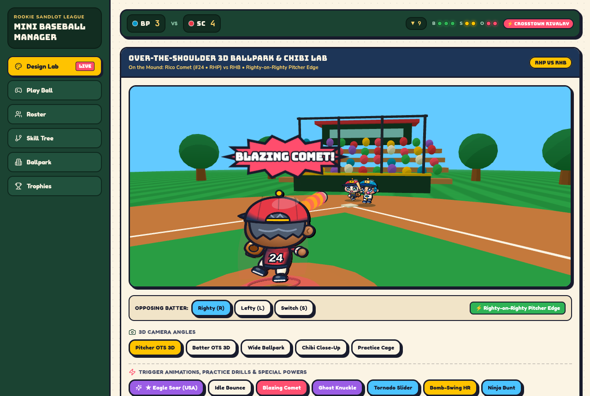
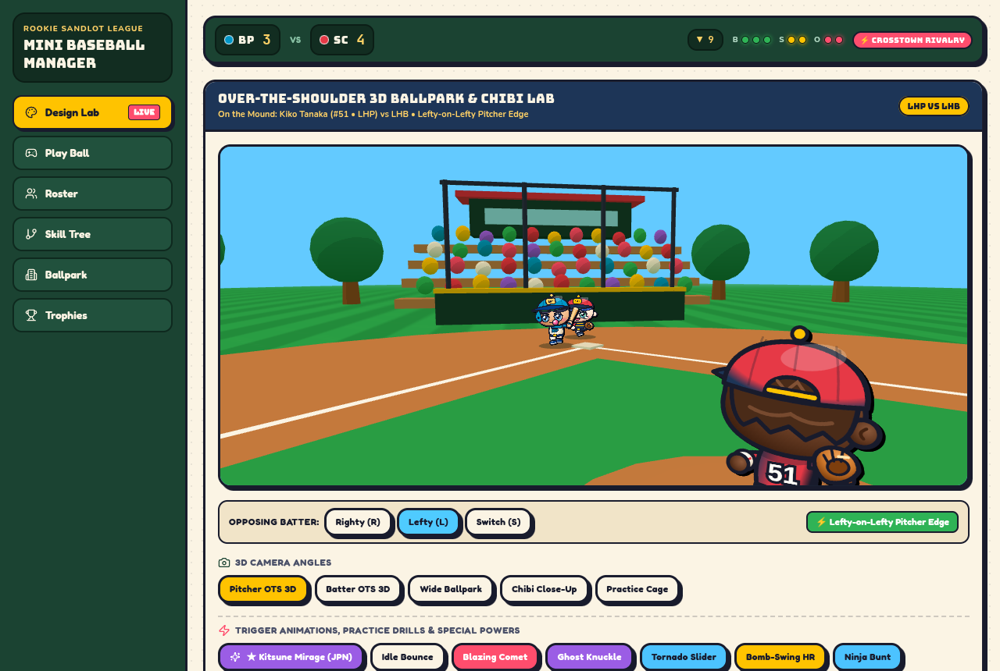
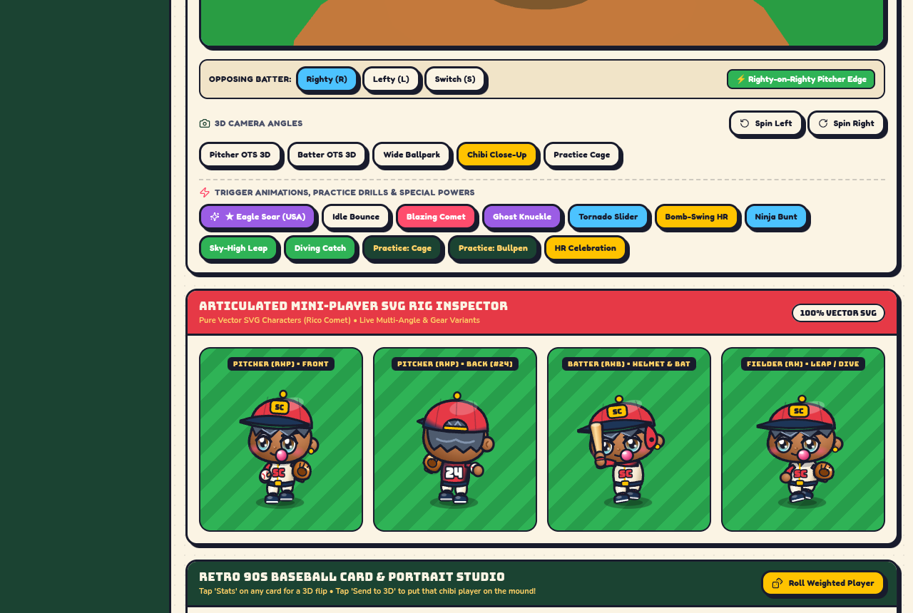
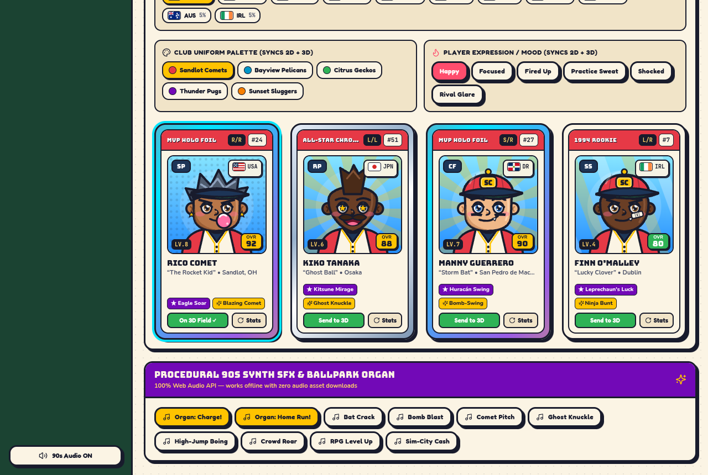

# ⚾ Mini Baseball Manager

[](./LICENSE)
[](https://github.com/nicholas-wagner/mini-baseball-manager/actions/workflows/ci.yml)
[](./vite.config.ts)

**Mini Baseball Manager** is an open-source, offline-first **retro 90s cartoon & volumetric 2.5D chibi baseball GM / Manager RPG** built for desktop and Android PWA.

Manage lineups, draft global prospects, develop branching player & manager skill trees, unleash cultural myth & animal Special Powers, build a Sim-City ballpark district, fuel multi-season team rivalries, and watch games unfold in **over-the-shoulder 3D**—all stored locally on your device with zero centralized backend.

---

## Visual Preview (Milestone 1 — Design-First Lab)

| Over-the-Shoulder 3D (RHP vs RHB) | Southpaw Matchup (LHP vs LHB) |
| :---: | :---: |
|  |  |

| 2.5D Volumetric Chibi SVG Rig Inspector | Retro 90s Baseball Cards & Cultural Powers |
| :---: | :---: |
|  |  |

---

## Core Pillars

- **90s Cartoon & 2.5D Chibi Visuals**: Collectible 90s manga & procedural baseball cards (3D card flip, Holo Foil frames, and **role-specific stats** for Pitchers vs. Batters/Fielders) paired with articulated ~1.8-head volumetric 2.5D chibi SVG players standing inside sunlit Three.js 3D ballparks.
- **Global Nationalities & Cultural Heritage Powers**: Weighted international roster generation with crisp vector SVG flags and 3-tier unlockable Myth/Animal Heritage Skill Branches (*Eagle Soar*, *Kitsune Mirage*, *Huracán Swing*, *Kangaroo Bounce*, *Leprechaun's Luck*, and more).
- **Deep Baseball Strategy, Speed-Driven Base Stealing, Co-Ed Archetypes & 2–60 Min Pacing**: Exact `B/T` platoon chess, `2–3` RP / `4–5` SP pitch arsenals, pitcher endurance velocity/break drop-off, full **Base Stealing** (`Steal 2B`, `Steal 3B`, `Double Steal`, `Steal Home`, defensive `Pitchout/Hold`, `SB/CS`, AI steals, live speed-driven odds), Defensive Shifts, Bullpen Warmups, Win Probability HUD, `5 / 7 / 9`-inning game formats + 1st-extra-inning 2B Ghost Runner, asymmetric co-ed traits & clubhouse synergies, and full sabermetrics (`AVG/OBP/SLG/OPS/ERA/WHIP/K9/Strike%/FPCT`).
- **Full GM Career, Sandlot-to-Majors Stadiums, World Spectacles & Serverless Sharing**: Start on a neighborhood **Rookie Sandlot (`500–1,500` fans)** with 6 fair-parity roster builds, evolve your 3D ballpark & capacity all the way up to **Pro Major League Cathedrals (`28,000–45,000` fans)** across `10` distinct retro venues with simulation Park Factors, run All-Star **Home Run Derbies**, the **Global Chibi Cup**, **Winter Ball**, **52 Narrative Surprise Events**, **Hall of Fame & 3D Retired Jersey Wall Plaques**, and share **PNG Baseball Cards** & offline `MBM1:` **Club Export Codes**!
- **Procedural 90s Web Audio (28 Cues)**: Zero-dependency Web Audio synthesizer & soundboard featuring bat cracks, organ riffs, *Stomp-Stomp-Clap!*, bullpen phone rings, ump calls, fireworks, and multi-formant pink-noise stadium crowd roars.

---

## Quick Start

```bash
# Install dependencies
npm install

# Launch the interactive Design Lab & dev server
npm run dev

# Run the TDD unit & component test suite
npm test

# Type-check, lint, and build the offline Android PWA
npm run typecheck && npm run lint && npm run build

# Run Desktop + Android Pixel 7 Playwright E2E tests
npm run test:e2e
```

---

## Project Blueprint & Roadmap

This repository is structured so both **human contributors** and **AI coding agents** can immediately understand the architecture, invariants, and exact next TDD ticket:

- **[PLAN.md](./PLAN.md)** — 10X Master Roadmap (`M0`–`M10`, 73 vertical slices) & live Progress Dashboard (**`70 / 73` done** — `M0`–`M9` complete; `M10` Story/Backstories/4-Slot Auto-Save queued!).
- **[docs/TASKS.md](./docs/TASKS.md)** — Atomic, dependency-ordered TDD task queue (`TASK-001`..`TASK-073`).
- **[docs/ARCHITECTURE.md](./docs/ARCHITECTURE.md)** — Canonical TypeScript interfaces, `PlayEvent` stream contracts, and 3D ballpark coordinates.
- **[docs/DESIGN_SYSTEM.md](./docs/DESIGN_SYSTEM.md)** — Exact 90s color tokens, typography, touch targets, and chibi scale units.
- **[AGENTS.md](./AGENTS.md)** — AI Agent onboarding guide, hard architectural invariants, and Definition of Done.

---

## Tech Stack

- **Frontend**: Vite 6, React 19, TypeScript (strict), Tailwind CSS v4, Zustand
- **3D & Art**: Imperative Three.js (`src/scene/`) + Procedural Vector SVG Portraits, Flags & 2.5D Chibi Rigs (`src/art/`)
- **Audio**: Procedural Web Audio API (`src/audio/`)
- **Testing (Strict TDD)**: Vitest, React Testing Library, jsdom, Playwright (Desktop & Android Pixel 7)
- **Offline & Mobile**: `vite-plugin-pwa` (Workbox Service Worker + Android adaptive/maskable icons) + local-only IndexedDB persistence

---

## Contributing & License

Contributions of all kinds are welcome! Please read [CONTRIBUTING.md](./CONTRIBUTING.md) and pick any `READY` ticket from [docs/TASKS.md](./docs/TASKS.md).

Released under the [MIT License](./LICENSE).
