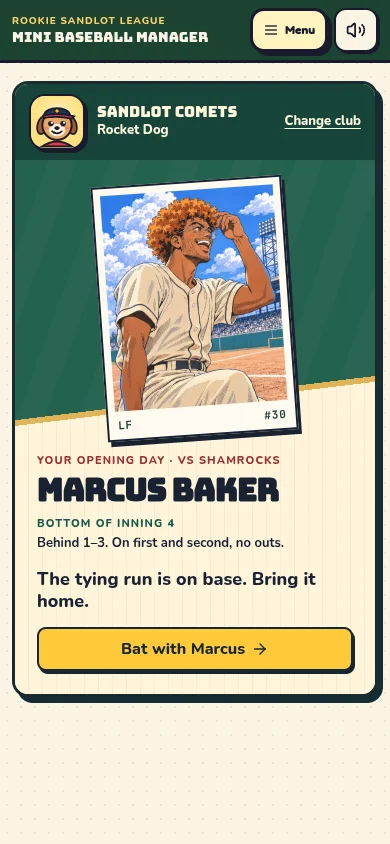
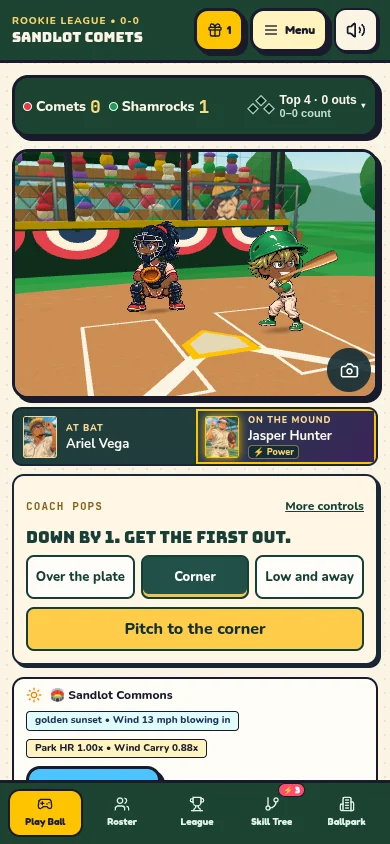
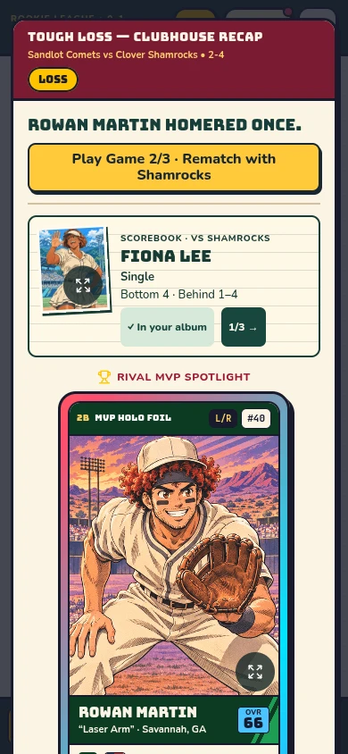
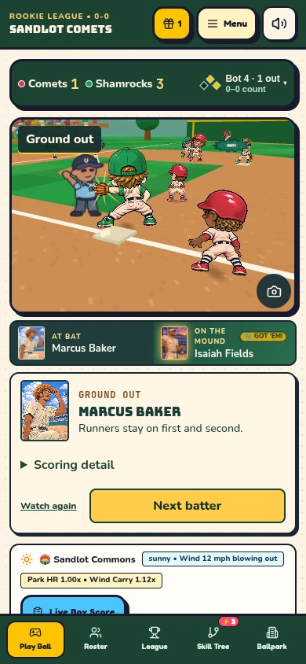
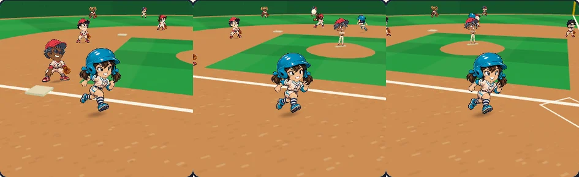

# ⚾ Mini Baseball Manager

[](./LICENSE)
[](https://github.com/nicholas-wagner/mini-baseball-manager/actions/workflows/ci.yml)
[](./vite.config.ts)

**Mini Baseball Manager** is an open-source, offline-first **baseball management RPG with painted miniature players and 3,000 illustrated manga cards** built for desktop and Android PWA.

Manage lineups, draft global prospects, develop branching player & manager skill trees, unleash cultural myth & animal Special Powers, build a Sim-City ballpark district, fuel multi-season team rivalries, and watch games unfold in **over-the-shoulder 3D**—all stored locally on your device with zero centralized backend.

---

## Your first game

Pick a club and meet the player holding the ball or stepping into the box. The Opening Day card shows the score, runners and outs in a late inning. Choose **Play Opening Day**, then tap the featured player to take over. Coach Pops stays with you through the half-inning. On the mound, choose a target and watch the catcher set up. At bat, try the compact swing or the power swing before you commit. **More controls** opens the full dugout immediately.

| Meet your player | Call your first pitch | Keep a play from the game |
| :---: | :---: | :---: |
|  |  |  |

Marcus Baker grounds out with two runners aboard. His card stays on screen while he runs through first. **Watch again** replays the throw. **Next batter** brings Ethan Torres to the plate with one out and both runners still on.

| Marcus’s groundout | Ethan’s turn |
| :---: | :---: |
|  |  |

[See the power swing preview on a phone](./docs/screenshots/batting-preview.webp).

<details>
<summary>Watch a third strike, a force at first and a runner rounding third</summary>




</details>

### The card collection

After a win or a loss, **Keep this moment** saves the illustrated player, opponent, inning, play and score to the club’s Trophy Album. The most recently saved play for that player appears beside their next live matchup card.

Each of the 3,000 players keeps their illustration when they change clubs. Open either live matchup card to inspect the hitter or pitcher. In the roster binder, choose **Print gallery** to browse a wall of illustrations. Tap a print to enlarge it. Switch back to **Stat cards** and flip one for the player’s role-specific ratings. The MVP gets a foil front and a headline drawn from that game’s box score.


---

## Core Pillars

- **GM-First Core Loop, Predetermined Home & Away Schedule, Sports-Page Recaps & Special Skill Trees**: Start a club in seconds and play through a predetermined **7-Series (21-Game) Home & Away Season Schedule** with live **3-Game Series Scoreboards** (*Rubber Matches*, *3-0 Sweep Bonuses*, and Road Trips inside rival 3D ballparks!), **Sports-Page Post-Series Recap Cards** (3 game scores, clickable Series MVP card & standings movement), **Pre-Game Probable Pitcher & Free-Agent Scout Cards** + 1-tap **Auto-Tune Lineup vs LHP/RHP**, clickable **League Leaders & Rival Club Cards**, and **Coach Pops' Manager Clipboard** — track your live **Promotion Chase & Season Owner Goal**, pick **1 focused Team Practice per game/series** (*Batting Cage*, *Bullpen Lab*, *Full-Squad*, or *Rest & Film*) and a **Pre-Series Gameplan** (*Balanced*, *Swing for the Fences*, *Small-Ball Chaos*, or *Bullpen Lockdown*) with real simulation trade-offs, react to **Incoming AI Trade Offers & Clubhouse Dilemmas**, spotlight **Hot-Hand / Breakout Watch** stars, swap tired starters in 1 tap, and let **1-tap Sim Next 3-Game Series** automatically grow core ratings while earning **Skill Points (SP)** for unified **Player & Manager Skill Trees** (with live nav badges for `🩺` injuries, `⚡` ready SP, `🏆` Playoffs, and `⬆` Ballpark upgrades).
- **Zero-Scroll Live 3D Games — Smart Watch, 3D Camera Switcher, Clutch Jump-In & Comic Pop-Art Juice**: Watch full games with **✨ Smart Watch** (cruises past routine pitches and auto-pauses right on homers, Coach Pops alerts, and 2-strike clutch spots!), flip 3D cameras anytime (**`Auto` / `Pitcher` / `Batter` / `Wide`**), or jump straight into the biggest late inning with **🔥 Play Clutch Moment** — featuring a dynamically updating **3D Center-Field Stadium Scoreboard**, a **Sticky Broadcast Scoreboard** (live **R / H / E**, inning, base diamond, and **B / S / O** count lamps), a live **TV Broadcast Lower-Third**, 1-tap **In-Game Baseball Card Viewer**, 1-tap **Arcade Bullpen Picker & Pinch-Hit Alerts**, comic confetti pop-art bursts with Coach Pops quips, and a 1-tap **Pro Manager** mode unlocking **Pitch Target / Guess Pitch Mind Games**, **Live Dugout Chess**, **Persistent Nemesis Grudges**, **1994 Foil Card Booster Packs**, live Weather & Defensive Shifts, and a toggleable **Pitch Math & d100 Dice-Roll Inspector**.
- **90s Manga Baseball Cards, Mobile Card Binder, Painted 2.5D Ballpark Players & Uniform Studio**: Collectible 90s manga baseball cards (3D card flip, Holo Foil frames, role-specific Pitcher vs. Batter stats, unique combinatorial bios, 1-tap PNG export, and a mobile-ready **Roster Card Binder** + 1-tap card modal on every lineup/bench/bullpen player), painted 2.5D ballpark players inside sunlit Three.js 3D ballparks, and a live **Uniform Studio** (6 jersey patterns, 4 cap styles, 4 stirrup styles, 6 crest emblems, custom colors/monograms & 6 retro 90s team kit presets).
- **25 Global Baseball Nations & Cultural Heritage Powers**: Full WBC international roster generation across **25 baseball nations** (*USA, Canada, Japan, South Korea, Mexico, Dominican Republic, Puerto Rico, Venezuela, Cuba, Chinese Taipei, Colombia, Netherlands, Italy, Brazil, Australia, Panama, China, Israel, Czechia, Great Britain, Nicaragua, South Africa, Spain, Argentina, Ireland*) with crisp vector SVG flags and 3-tier unlockable Myth/Animal Heritage Powers that actively modify gameplay.
- **Deep Baseball Strategy, Speed-Driven Base Stealing & Co-Ed Archetypes**: Exact `B/T` platoon chess, `2–3` RP / `4–5` SP pitch arsenals, pitcher endurance velocity/break drop-off, full **Base Stealing** (`Steal 2B`, `Steal 3B`, `Double Steal`, `Steal Home`, defensive `Pitchout/Hold`, `SB/CS`, AI steals, live speed-driven odds), Defensive Shifts, Bullpen Warmups, Win Probability & Strike-Zone HUD, `5 / 7 / 9`-inning formats + 1st-extra-inning 2B Ghost Runner, asymmetric co-ed traits, and full sabermetrics (`AVG/OBP/SLG/OPS/ERA/WHIP/K9/Strike%/FPCT`).
- **Full GM Career, Sim-City Ballpark HQ, World Spectacles & Pass-and-Play Duels**: Climb from a neighborhood **Rookie Sandlot (`500–1,500` fans)** to **Pro Major League Cathedrals (`28,000–45,000` fans)** across `10` retro venues with Park Factors, playable **Best-of-3 Postseason Brackets**, Ticket/Concession/Sponsor/District Grid economy, **The Sandlot Gazette**, **52 Narrative Surprise Cards**, **Trade Machine**, **6-Slot Prospect Farm Academy**, hireable **Coaching, Equipment & Medical Staff** (including retired club legends!), **Season Awards & Hall of Fame**, **All-Star Home Run Derby**, **Global Chibi Cup**, **199X Time Capsule Scenarios**, and offline `MBM1:` **Pass-and-Play Friend Boss Duels**.
- **4-Slot Auto-Save, Coach Pops' Guide & 8 Replayable CYOA Backstories**: Automatic local saving & resume across **4 Career Save Slots**, an illustrated **Dugout Handbook**, **8 replayable Manager Backstories** (24 branching CYOA chapters), and an Accessibility/Settings drawer (SFX volume, haptics, wake lock, reduced motion & colorblind stat symbols).
- **Procedural 90s Web Audio (40 SFX Cues + 10 Unique Stadium Soundtracks)**: Zero-dependency Web Audio synthesizer featuring 40 ballpark cues (*Stomp-Stomp-Clap!*, *7th-Inning Stretch*, airhorns, fireworks, multi-formant pink-noise crowds) plus a global **90s Arcade Stadium Jukebox** with a unique theme for every ballpark *(the full 40-cue Ballpark Soundboard lives inside the hidden `5× 'd'` Design Lab)*.

---

## Quick Start

```bash
# Install dependencies
npm install

# Launch the app & dev server (press "d" 5 times anywhere outside text inputs to toggle the hidden Design Lab!)
npm run dev

# Run the TDD unit & component test suite
npm test

# Type-check, lint, and build the offline Android PWA
npm run typecheck && npm run lint && npm run build

# Run Desktop + Android Pixel 7 Playwright E2E tests
npm run test:e2e
```

### Android PWA Hosting (GitHub Pages)

Live PWA: **https://nicholas-wagner.github.io/mini-baseball-manager/**

Pushing to `main` automatically runs [`.github/workflows/deploy-pages.yml`](./.github/workflows/deploy-pages.yml), building the offline Workbox Service Worker (`~4.6 MB` core precache with `CacheFirst` runtime caching for manga portrait PNGs) and publishing to GitHub Pages. Open the live HTTPS URL in Android Chrome and tap **Install App** to play fullscreen offline!

---

## Project Blueprint & Roadmap

This repository is structured so both **human contributors** and **AI coding agents** can immediately understand the architecture, invariants, and exact next TDD ticket:

- **[PLAN.md](./PLAN.md)** — 10X Master Roadmap (`M0`–`M10`, 73 vertical slices) & live Progress Dashboard (**`73 / 73` — 100% Complete!**).
- **[docs/SIMULATION_MATH.md](./docs/SIMULATION_MATH.md)** — Full pitch-by-pitch seeded dice-roll formulas, all 15 attribute effects, National/Capstone powers, Weather, Shifts, Mind Games & Nemesis math.
- **[docs/TASKS.md](./docs/TASKS.md)** — Atomic, dependency-ordered TDD task queue (`TASK-001`..`TASK-073`).
- **[docs/ARCHITECTURE.md](./docs/ARCHITECTURE.md)** — Canonical TypeScript interfaces, `PlayEvent` stream contracts, and 3D ballpark coordinates.
- **[docs/DESIGN_SYSTEM.md](./docs/DESIGN_SYSTEM.md)** — Exact 90s color tokens, typography, touch targets, and chibi scale units.
- **[AGENTS.md](./AGENTS.md)** — AI Agent onboarding guide, hard architectural invariants, and Definition of Done.

---

## Tech Stack

- **Frontend**: Vite 6, React 19, TypeScript (strict), Tailwind CSS v4, Zustand
- **3D & Art**: Imperative Three.js (`src/scene/`) + illustrated PNG player cards, SVG flags and shared painted 2.5D rigs (`src/art/`)
- **Audio**: Procedural Web Audio API (`src/audio/`)
- **Testing (Strict TDD)**: Vitest, React Testing Library, jsdom, Playwright (Desktop & Android Pixel 7)
- **Offline & Mobile**: `vite-plugin-pwa` (Workbox Service Worker + Android adaptive/maskable icons) + local-only IndexedDB persistence

---

## Contributing & License

Contributions of all kinds are welcome! Please read [CONTRIBUTING.md](./CONTRIBUTING.md) and pick any `READY` ticket from [docs/TASKS.md](./docs/TASKS.md).

Released under the [MIT License](./LICENSE).
