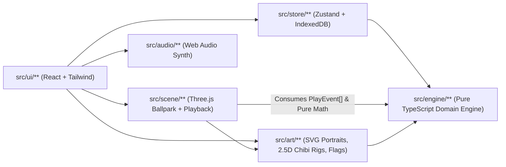

# Mini Baseball Manager — Canonical Architecture & Domain Contracts

> **Purpose**: Single source of truth for TypeScript interfaces, event streams, and storage schemas across `src/engine/`, `src/scene/`, `src/store/`, and `src/ui/`. Any AI agent building a new feature MUST align with these contracts so parallel slices integrate seamlessly.

---

## 1. Strict Dependency Direction



- **Rule**: `src/engine/**` NEVER imports from `src/ui/**`, `src/scene/**`, `src/store/**`, `src/audio/**`, or browser globals (`window`, `document`, `indexedDB`).
- **Rule**: `src/engine/**` only imports pure types/modules inside `src/engine/**` (exception: `BallVfxStyle` type-only import if kept pure; prefer defining `BallFlightStyle` inside `src/engine/models/` and re-exporting in `src/scene/vfx/`).

---

## 2. Core Domain Interfaces (`src/engine/models/`)

### 2.1 Player & RPG Profile (`src/engine/models/player.ts`)

```ts
import type { PortraitTraits, CardRarity } from '../../art/portraits/types';
import type { BatsHand, FieldPosition, ThrowsHand } from '../handedness/types';
import type { NationalityId } from '../nationalities/types';

export type PersonalityArchetype =
  | 'prankster'
  | 'clutch_captain'
  | 'quiet_assassin'
  | 'showboat'
  | 'gym_rat'
  | 'superstitious'
  | 'rival_hunter';

export type FormState = 'blazing' | 'hot' | 'neutral' | 'cold' | 'frozen';

export interface PlayerRatings {
  // Batting (1–99)
  contact: number;
  power: number;
  eye: number;
  bunt: number;
  // Pitching (1–99)
  velocity: number;
  movement: number;
  control: number;
  stamina: number;
  // Athleticism & Intangibles (1–99)
  speed: number;
  fielding: number;
  arm: number;
  clutch: number;
  popularity: number;
  potential: number;
}

export interface PlayerContract {
  salaryPerSeason: number;
  yearsRemaining: number;
  signingBonus: number;
  noTradeClause?: boolean;
}

export interface PlayerSeasonStats {
  games: number;
  atBats: number;
  hits: number;
  doubles: number;
  triples: number;
  homeRuns: number;
  rbis: number;
  walks: number;
  strikeouts: number;
  stolenBases: number;
  inningsPitchedOuts: number; // stored in outs (e.g. 21 outs = 7.0 IP) to avoid float error
  earnedRuns: number;
  pitchingStrikeouts: number;
  pitchingWalks: number;
  wins: number;
  losses: number;
  saves: number;
  errors: number;
}

export interface Player {
  id: string;
  name: string;
  nickname: string;
  age: number;
  position: FieldPosition;
  secondaryPositions: FieldPosition[];
  bats: BatsHand;
  throws: ThrowsHand;
  jerseyNumber: number;
  nationalityId: NationalityId;
  hometown: string;
  personality: PersonalityArchetype;
  rarity: CardRarity;
  traits: PortraitTraits;
  bio: string;

  // RPG Progression
  level: number;
  xp: number;
  skillPoints: number;
  unlockedSkillIds: string[];
  equippedPowerIds: string[]; // max 2 (3 at Legend LV >= 12)
  equippedRelicIds: string[]; // max 2 90s Gear Relics
  heritageTierUnlocked: 0 | 1 | 2 | 3;

  // Live Status & Form
  ratings: PlayerRatings;
  fatigue: number; // 0 (fresh) .. 100 (exhausted)
  morale: number; // 0 .. 100
  formScore: number; // -100 (frozen slump) .. +100 (blazing hot streak)
  formState: FormState;

  // Club & History
  contract: PlayerContract;
  formerClubIds: string[]; // enables poached-player Revenge Matchups!
  seasonStats: PlayerSeasonStats;
  careerStats: PlayerSeasonStats;
  awards: string[];
}
```

### 2.2 Club, Lineup & Stadium District (`src/engine/models/club.ts`)

```ts
export type LeagueTierId = 'rookie' | 'low_a' | 'high_a' | 'aa' | 'aaa' | 'majors';

export type AiArchetype =
  | 'mashers'
  | 'speed_demons'
  | 'ace_factory'
  | 'defense_first'
  | 'moneyball';

export interface LineupSlot {
  orderIndex: number; // 0..8
  playerId: string;
  defensivePosition: Exclude<FieldPosition, 'SP' | 'RP'> | 'DH';
}

export interface ClubColors {
  primary: string;
  secondary: string;
  accent: string;
  monogram: string;
}

export interface DistrictTile {
  slotId: string; // e.g., 'north-1', 'east-2'
  buildingId: string | null; // e.g., 'nacho_cantina', 'pitching_lab', 'bobblehead_shop'
  tier: 1 | 2 | 3;
}

export interface StadiumState {
  name: string;
  seatingTier: 1 | 2 | 3 | 4; // Bleachers -> Grandstand -> Double-Deck -> Mega Dome
  capacity: number;
  hasJumbotron: boolean;
  hasNightLights: boolean;
  hasMascotCannon: boolean;
  themeId: string;
  retiredNumbers: { jerseyNumber: number; playerName: string }[];
  championshipPennants: { season: number; leagueTier: LeagueTierId }[];
  districtTiles: DistrictTile[];
}

export interface ClubEconomy {
  cash: number;
  fanBase: number;
  teamHype: number; // 0..100
  ticketPrice: number;
  concessionPrice: number;
  concessionQuality: 1 | 2 | 3;
  scoutingBudget: number;
  tvContractId: string | null;
  activeSponsorIds: string[];
}

export interface Club {
  id: string;
  isHuman: boolean;
  city: string;
  name: string;
  mascot: string;
  colors: ClubColors;
  leagueTier: LeagueTierId;
  aiArchetype: AiArchetype;
  roster: Player[];
  academyProspects: Player[]; // up to 6 youth farm players
  lineup: LineupSlot[]; // 9 slots
  rotationIds: string[]; // 3–5 starting pitchers
  bullpenIds: string[];
  rotationCursor: number;
  coaches: CoachStaffState;
  stadium: StadiumState;
  economy: ClubEconomy;
  wins: number;
  losses: number;
  streak: number; // +N win streak, -N losing streak
}
```

### 2.3 Simulation Event Stream Contract (`src/engine/models/playEvent.ts`)

The simulation engine (`src/engine/simulation/`) emits pure `PlayEvent` objects. The 3D Scene Playback Controller (`src/scene/playback/`) consumes them to animate pitches, swings, all 9 fielders, baserunners, VFX, comic callouts, and audio cues!

```ts
export type PlayEventType =
  | 'game_start'
  | 'inning_start'
  | 'at_bat_start'
  | 'manager_power_used'
  | 'pitch_thrown'
  | 'ball_in_play'
  | 'stolen_base_attempt'
  | 'pitching_change'
  | 'inning_end'
  | 'game_end';

export type AtBatOutcome =
  | 'ball'
  | 'called_strike'
  | 'swinging_strike'
  | 'foul'
  | 'walk'
  | 'strikeout'
  | 'single'
  | 'double'
  | 'triple'
  | 'home_run'
  | 'ground_out'
  | 'fly_out'
  | 'line_out'
  | 'double_play'
  | 'sac_fly'
  | 'fielding_error'
  | 'bunt_single'
  | 'bunt_out';

export interface PlayEvent {
  seq: number;
  type: PlayEventType;
  inning: number;
  half: 'TOP' | 'BOT';
  outsBefore: number;
  outsAfter: number;
  balls: number;
  strikes: number;
  awayScore: number;
  homeScore: number;
  basesAfter: [string | null, string | null, string | null]; // 1B, 2B, 3B runner IDs
  batterId?: string;
  pitcherId?: string;
  outcome?: AtBatOutcome;
  isClutchMoment: boolean; // Triggers Clutch Cam zoom-in!
  isRivalrySpark?: boolean;
  specialPowerTriggered?: {
    actor: 'pitcher' | 'batter' | 'fielder' | 'manager';
    powerId: string;
    calloutText: string;
    vfxColor: string;
  };
  ballFlight?: {
    style: BallVfxStyle;
    landingX: number;
    landingZ: number;
    apexY: number;
    durationSec: number;
  };
  fieldingHighlight?: {
    fielderId: string;
    fielderPos: FieldPosition;
    anim: 'field_run' | 'field_dive' | 'field_high_jump';
  };
  commentary: string;
  soundCue?: SoundCue;
  xpAwards?: { playerId: string; xp: number }[];
}
```

### 2.4 Local Persistence Schema (`src/store/persistence.ts`)

```ts
export const CURRENT_SAVE_SCHEMA_VERSION = 1;

export interface SaveSlotMetadata {
  slotId: 'slot-1' | 'slot-2' | 'slot-3';
  clubName: string;
  leagueTier: LeagueTierId;
  seasonNumber: number;
  recordLabel: string; // e.g., "14-7"
  updatedAtIso: string;
  schemaVersion: number;
}

export interface SaveFileV1 {
  schemaVersion: 1;
  savedAtIso: string;
  worldSeed: number;
  seasonNumber: number;
  currentSeriesIndex: number;
  humanClubId: string;
  manager: ManagerProfile;
  leagues: Record<LeagueTierId, Club[]>;
  rivalries: RivalryRecord[];
  trophies: TrophyRecord[];
  newspaperArchive: NewspaperIssue[];
  unlockedCosmeticIds: string[];
  settings: {
    muted: boolean;
    volume: number;
    defaultGameSpeed: 1 | 2 | 4;
    defaultWatchMode: 'live' | 'clutch' | 'sim';
    reducedMotion: boolean;
    hapticsEnabled: boolean;
  };
}
```

---

## 3. 3D World Coordinate Reference (`src/scene/`)

| Landmark | World `(x, y, z)` | Notes |
| :--- | :--- | :--- |
| Home Plate | `(0, 0, 0)` | Catcher at `(0, 0.04, 1.75)` facing `-Z` |
| Right-Handed Batter's Box | `(-0.95, 0.04, 0.15)` | 3rd-base side (`-X`) |
| Left-Handed Batter's Box | `(+0.95, 0.04, 0.15)` | 1st-base side (`+X`) |
| Pitcher's Mound | `(0, 0.24, -10.2)` | Pitcher faces `+Z` (`logicalYaw = 0`) |
| 1st Base | `(+9.8, 0, -9.8)` | 1B defender near `(8.8, 0.04, -11.4)` |
| 2nd Base | `(0, 0, -19.6)` | 2B `(4.6, 0.04, -17.6)`, SS `(-4.6, 0.04, -17.6)` |
| 3rd Base | `(-9.8, 0, -9.8)` | 3B defender near `(-8.8, 0.04, -11.4)` |
| Outfielders | `LF (-15, 0.04, -27)`, `CF (0, 0.04, -32)`, `RF (+15, 0.04, -27)` | Facing `+Z` toward home plate |
| Outfield Wall Arc | Radius `40` centered at `(0, 0, -3)` | Scoreboard at `(0, 7.6, -44.2)` |
| Behind-Home Grandstand | `z = 9.2..15.2` | Visible behind catcher in Pitcher OTS 3D |
