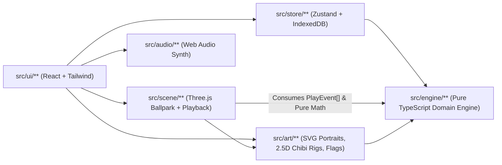

# Mini Baseball Manager — Canonical Architecture & Domain Contracts

> **Purpose**: Single source of truth for TypeScript interfaces, event streams, and storage schemas across `src/engine/`, `src/scene/`, `src/store/`, and `src/ui/`. Any AI agent building a new feature MUST align with these contracts so parallel slices integrate seamlessly.

---

## 1. Strict Dependency Direction



- **Rule**: `src/engine/**` NEVER imports from `src/ui/**`, `src/scene/**`, `src/store/**`, `src/audio/**`, or browser globals (`window`, `document`, `indexedDB`).
- **Rule**: `src/engine/**` only imports pure types/modules inside `src/engine/**` (exception: `BallVfxStyle` type-only import if kept pure; prefer defining `BallFlightStyle` inside `src/engine/models/` and re-exporting in `src/scene/vfx/`).

---

## 2. Core Domain Interfaces (`src/engine/models/`)

### 2.1 Player & RPG Profile (`src/engine/models/player.ts`)

```ts
import type { PortraitTraits, CardRarity } from '../../art/portraits/types';
import type { BatsHand, FieldPosition, ThrowsHand } from '../handedness/types';
import type { NationalityId } from '../nationalities/types';

export type PersonalityArchetype =
  | 'prankster'
  | 'clutch_captain'
  | 'quiet_assassin'
  | 'showboat'
  | 'gym_rat'
  | 'superstitious'
  | 'rival_hunter';

export type FormState = 'blazing' | 'hot' | 'neutral' | 'cold' | 'frozen';

export type PlayerSpecialistArchetype =
  | 'balanced_regular'
  | 'contact_technician'   // High contact/eye hitter specialist, modest power/glove
  | 'power_slugger'        // Elite HR/RBI bat specialist, slower speed & weaker defense
  | 'defensive_wizard'     // Elite glove/arm/range specialist, lighter bat
  | 'speed_smallball'      // Blazing speed, bunt & steal specialist
  | 'super_utility'        // Multi-position glue specialist
  | 'flame_closer'         // High-velocity/K short-stamina relief specialist
  | 'crafty_tactician'     // Pinpoint control/movement pitcher specialist
  | 'southpaw_specialist'  // Situational matchup specialist
  | 'workhorse_ace';       // High-stamina starter

export type PositionalFlexibilityProfile =
  | 'single_position'      // e.g., strictly 1B-only or C-only
  | 'middle_infield_pair'  // SS + 2B only
  | 'corner_infield_pair'  // 1B + 3B only
  | 'infield_utility'      // Any infield spot (1B, 2B, 3B, SS)
  | 'corner_outfield_pair' // LF + RF only
  | 'all_outfield'         // LF + CF + RF
  | 'catcher_first'        // C + 1B
  | 'swingman_pitcher';    // SP + RP

export type PlayerMarketTier =
  | 'rookie'         // Young (18-21), cheap, high XP growth (1.35x), variable max statCaps
  | 'all_star'       // Rare, elite peak ratings + fan draw, very expensive contracts
  | 'veteran'        // Older (31-38), solid quality now at affordable pay, minimal growth (0.30x XP)
  | 'above_average'  // Strong reliable starter, starter-level pay, moderate upside
  | 'average'        // Fair-salaried everyday regular, balanced tools
  | 'below_average'; // League-minimum depth, often carries 1 sharp specialist tool

export type PitchType =
  | 'four_seam'    // 4-Seam Fastball (pure velocity, riding heat)
  | 'two_seam'     // 2-Seam / Sinker (arm-side tail, groundball heavy)
  | 'cutter'       // Cut Fastball (late glove-side bite, jams opposite-hand bats)
  | 'slider'       // Slider (sharp lateral sweep, two-strike chase weapon)
  | 'curveball'    // 12-6 / Knuckle-Curve (big vertical drop, speed change)
  | 'changeup'     // Circle Change (arm-speed deception, fades away)
  | 'splitter'     // Split-Finger / Forkball (late bottom-out drop)
  | 'knuckleball'; // Rare dancing flutterball (unpredictable break, lower velo)

export interface PitchSlot {
  pitchType: PitchType;
  mastery: number; // 1..99 per-pitch effectiveness & command feel
}

export interface PitcherArsenalProfile {
  // Strictly 2–3 pitches for Relievers ('RP'), 4–5 pitches for Starters ('SP')
  repertoire: PitchSlot[];
  favoritePitch: PitchType; // Highest-mastery "Out Pitch" (+6 Stuff, +4 Control; decays if spammed 3+ pitches in a row)
  weakestPitch: PitchType;  // Lowest-mastery "Show-Me Pitch" (-6 Stuff, -5 Control; trainable via Pitch Lab trade-offs)
}

export interface BatterPitchProfile {
  favoritePitch: PitchType; // Pitch they crush (e.g., Curveball Crusher, Dead-Red Fastball Hitter: +10..+16)
  weakPitch: PitchType;     // Pitch vulnerability (e.g., Slider Chase Hole, Changeup Timing Flaw: -10..-16)
  pitchRecognition: Partial<Record<PitchType, number>>; // -20..+20 per-pitch Contact/Power/Eye & chase modifier
}

export type MentalTraitId =
  | 'clubhouse_glue'    // Good clubhouse guy: lifts team morale recovery & chemistry, cushions losing streaks
  | 'high_energy'       // Sparkplug: accelerates Team Hype gain (+20%) and energizes rallies
  | 'ice_veins'         // Ice in their veins: sharp bonus in critical / high-Leverage Index moments
  | 'pressure_riser'    // Big-game performer: scales up Contact/Power/Control under playoff/rivalry stakes
  | 'pressure_wilt'     // Tightens up: loses Contact/Eye/Control/Stuff when Leverage Index is high
  | 'steady_hand'       // Even keel: resistant to slump spirals and pressure swings
  | 'fiery_competitor'; // Bulldog: extra edge in rivalry games & jams, higher fatigue burn

export type PressureResponseProfile =
  | 'ice_veins'
  | 'clutch_riser'
  | 'steady'
  | 'pressure_wilt';

export type PitcherRole =
  | 'starter'         // SP (4–5 pitches): high stamina, built for 5–7+ innings
  | 'long_reliever'   // RP (3 pitches): high-stamina bridge / mop-up / extra-inning reliever
  | 'short_reliever'  // RP (2–3 pitches): 1-inning middle-relief burst
  | 'loogy'           // RP (2–3 pitches, throws 'L'): Lefty One-Out Guy with amplified L-vs-L platoon break
  | 'setup_man'       // RP (2–3 pitches): 7th–8th inning high-leverage bridge
  | 'closer'          // RP (2–3 pitches): 9th+ inning save specialist (+Stuff/+CTL in save spots)
  | 'fireman';        // RP (2–3 pitches): multi-inning high-LI jam stopper deployed with runners on base!

export type GamePressureLevel =
  | 'regular'
  | 'series_rubber'
  | 'rivalry_showdown'
  | 'playoff_game'
  | 'elimination_championship';

export type BattedBallTendency =
  | 'groundball'
  | 'line_drive'
  | 'flyball'
  | 'balanced';

export interface BattedBallProfile {
  tendency: BattedBallTendency;
  gbRateBias: number;    // -12..+12 percentage-point shift on Ground Ball Rate (GB%)
  ldRateBias: number;    // -8..+8 percentage-point shift on Line Drive Rate (LD%)
  fbRateBias: number;    // -12..+12 percentage-point shift on Fly Ball Rate (FB%)
  popUpRateBias: number; // -8..+8 percentage-point shift on Pop-Up Rate (PopUp%)
}

export type CareerExperienceTier =
  | 'rookie_green'  // 0–14 expScore: 0 seasons / green rookie (-1..-2 high-LI jitters, offset by 1.35x skill growth)
  | 'developing'    // 15–39 expScore: 1–2 seasons / ~20–55 games (neutral composure)
  | 'seasoned'      // 40–69 expScore: 3–5 seasons / ~60–115 games (+1 Eye/Control, +1 high-LI composure)
  | 'cagey_veteran';// 70–100 expScore: 6+ seasons / 120+ games / 450+ PAs or 180+ IP (+2..+3 Eye/Control, +2 high-LI poise, -15% rust)

export interface CareerServiceProfile {
  seasonsPlayed: number;       // Legitimately earned season-by-season (veterans spawn with 6–12, rookies at 0)
  careerPlayoffGames: number;  // High-leverage postseason games logged
  experienceScore: number;     // 0..100 derived slowly from seasonsPlayed + careerGames + PAs/IP + playoffGames
  experienceTier: CareerExperienceTier;
}

export type GameLengthInnings = 5 | 7 | 9; // 5 = Sandlot Blitz (~2 min), 7 = Doubleheader (~4 min), 9 = Classic

export interface PitcherEnduranceEffect {
  enduranceRemaining: number; // 100 (fresh) .. 0 (gassed)
  tier: 'fresh' | 'solid' | 'tiring' | 'fatigued' | 'gassed';
  mphDrop: number;            // 0 .. -7 mph fastball/sinker/cutter radar drop
  breakDrop: number;          // 0 .. -15 drop in sinker sink, slider sweep, curve/splitter drop
  controlDrop: number;        // 0 .. -10 command fade / hanger risk
  gbRateShift: number;        // sinker/two-seam loses groundball sink when tired!
  scoutWarning?: string;      // e.g. "Sinker losing drop — Bullpen time!"
}

export interface PlayerRatings {
  // Batting (1–99) — drives AVG, OBP, SLG, OPS, BB%, K%
  contact: number;
  power: number;
  gapPower: number; // Extra-base 2B/3B drive power (SLG / OPS)
  eye: number;      // Plate discipline & Walk Rate (BB% / OBP)
  bunt: number;
  // Pitching (1–99) — drives Strike%, BB/9, K/9, WHIP, ERA
  velocity: number;
  movement: number;
  control: number;  // Strike-zone command (Strike% & Walk Rate)
  stamina: number;
  // Athleticism, Defense & Intangibles (1–99)
  speed: number;
  fielding: number; // Glove & hands -> Fielding Percentage (FPCT)
  range: number;    // Footwork & reaction -> converting line drives & grounders into outs
  arm: number;      // Arm strength -> gunning down runners & limiting extra bases
  clutch: number;   // High-leverage performance multiplier
  luck: number;     // Subtle universal edge (BABIP bloops, borderline calls, error bounces)
  popularity: number;
  potential: number;
}

export interface PlayerContract {
  salaryPerSeason: number;
  yearsRemaining: number;
  signingBonus: number;
  noTradeClause?: boolean;
}

export interface PlayerSeasonStats {
  games: number;
  plateAppearances?: number;
  atBats: number;
  hits: number;
  doubles: number;
  triples: number;
  homeRuns: number;
  rbis: number;
  walks: number;
  strikeouts: number;
  sacFlies?: number;
  stolenBases: number;
  // Batted-ball counts (for AVG/OBP/SLG/OPS/BABIP + GB%/LD%/FB%/PopUp%)
  groundBalls?: number;
  lineDrives?: number;
  flyBalls?: number;
  popUps?: number;
  // Pitching counts (for ERA, WHIP, K/9, BB/9, Strike%, GB%/LD%/PopUp%)
  inningsPitchedOuts: number; // stored in outs (e.g. 21 outs = 7.0 IP) to avoid float error
  hitsAllowed?: number;
  homeRunsAllowed?: number;
  earnedRuns: number;
  pitchingStrikeouts: number;
  pitchingWalks: number;
  pitchesThrown?: number;
  strikesThrown?: number;
  ballsThrown?: number;
  wins: number;
  losses: number;
  saves: number;
  holds?: number;
  // Fielding counts (for FPCT & Range Factor)
  putouts?: number;
  assists?: number;
  errors: number;
}

export interface Player {
  id: string;
  name: string;
  nickname: string;
  age: number;
  position: FieldPosition;
  secondaryPositions: FieldPosition[];
  bats: BatsHand;
  throws: ThrowsHand;
  jerseyNumber: number;
  nationalityId: NationalityId;
  hometown: string;
  personality: PersonalityArchetype;
  rarity: CardRarity;
  traits: PortraitTraits;
  bio: string;

  // RPG Progression
  level: number;
  xp: number;
  skillPoints: number;
  unlockedSkillIds: string[];
  equippedPowerIds: string[]; // max 2 (3 at Legend LV >= 12)
  equippedRelicIds: string[]; // max 2 90s Gear Relics
  heritageTierUnlocked: 0 | 1 | 2 | 3;

  // Live Status & Form
  marketTier: PlayerMarketTier;
  specialistArchetype: PlayerSpecialistArchetype;
  pitcherRole?: PitcherRole; // starter | long_reliever | short_reliever | loogy | setup_man | closer | fireman
  flexibilityProfile: PositionalFlexibilityProfile;
  favoritePosition: FieldPosition; // Playing favorite position awards +5 Fielding/+4 Control, +3 Clutch, +5 Morale
  positionProficiency: Partial<Record<FieldPosition, number>>; // 0..100; < 50 triggers Out-of-Position penalty
  pitchArsenal?: PitcherArsenalProfile; // Populated for SP (4–5 pitches) & RP (2–3 pitches)
  batterPitchProfile: BatterPitchProfile; // Favorite pitch to crush, pitch weakness & trainable recognition map
  battedBallProfile?: BattedBallProfile; // Drives GB% / LD% / FB% / PopUp% tendencies for batters & pitchers
  mentalTraits?: MentalTraitId[]; // Good clubhouse guy, high energy, ice veins, pressure riser/wilter, etc.
  pressureProfile?: PressureResponseProfile; // ice_veins | clutch_riser | steady | pressure_wilt
  careerService?: CareerServiceProfile; // Slow-earned seasons/games/ABs/IP experience granting veterans a subtle edge over rookies
  ratings: PlayerRatings;
  statCaps: PlayerRatings; // Per-tool max rating ceilings (1..99), widest variance on rookies
  totalRatingBudget: number; // Archetype + marketTier tool envelope preventing generic 99-all-stat overpowered clones (rare 'all_star' carries elite budget)
  xpGrowthMultiplier: number; // 1.35 (rookie) .. 0.30 (veteran)
  fatigue: number; // 0 (fresh) .. 100 (exhausted)
  morale: number; // 0 .. 100
  formScore: number; // -100 (frozen slump) .. +100 (blazing hot streak)
  formState: FormState;

  // Club & History
  contract: PlayerContract;
  formerClubIds: string[]; // enables poached-player Revenge Matchups!
  seasonStats: PlayerSeasonStats;
  careerStats: PlayerSeasonStats;
  awards: string[];
}
```

#### 2.1.1 Market Tiers, Pitch Arsenals, Compromise Training & Ability Scarcity Rules

| Market Tier | Age Band | Cost / Salary | XP Growth | Max `statCaps` / Upside | Strategic Role |
| :--- | :---: | :--- | :---: | :--- | :--- |
| **`rookie`** | 18–21 | Very cheap rookie deal | `1.35x` | **Wild variance** (boom-or-bust ceilings) | Draft & farm gems to develop |
| **`all_star`** | 24–29 | Rare & very expensive | `0.85x` | Peak 85–99 tools + popularity surge | Franchise centerpiece if affordable |
| **`veteran`** | 31–38 | Affordable short-term pay | `0.30x` | Minimal room to improve (at cap) | Plug-and-play quality + mentorship |
| **`above_average`** | 23–29 | Solid starter salary | `0.95x` | Good-to-strong 72–86 ceilings | Core everyday starters |
| **`average`** | 22–30 | Balanced middle pay | `0.85x` | 64–76 steady ceilings | Dependable rotation & lineup fillers |
| **`below_average`** | 20–32 | League minimum bargain | `0.75x` | Low overall floor, often **1 sharp specialist tool** | Late-inning glove, speed, or matchup role player |

- **Favorite Position & Out-of-Position Rules**: Deploying a player at `favoritePosition` grants **Favorite Position Boost** (`+5 Fielding` or `+4 Control` on mound, `+3 Clutch`, `+5 Morale`). Deploying them at a listed position with proficiency `>= 50` plays cleanly at normal rating. Deploying them below `50` or unlisted triggers Out-of-Position fielding/error penalties.
- **Cross-Training Trade-Off**: Training a new eligible position consumes a Practice turn (opportunity cost vs batting/pitching/slump drills), increases `positionProficiency[targetPos]` by `+12..+20`, and applies **`-4..-8` positional rust decay** to other secondary/current positions until sharpened again. Reaching `95+` mastery unlocks shifting `favoritePosition` to the newly mastered position.
- **Role-Locked Pitcher Arsenals (`2–3` RP vs `4–5` SP)**: Relievers (`RP`) carry strictly **`2` or `3` pitches** (high short-burst bite, faster second-time-through exposure); Starters (`SP`) carry strictly **`4` or `5` pitches** (at least one fastball + breaking/offspeed mix). Every pitcher has a **`favoritePitch`** (*Out Pitch*: `+6 Stuff / +4 Control`, with `-4` predictability decay per consecutive repeat past 2 in the same PA) and a **`weakestPitch`** (*Show-Me Pitch*: `-6 Stuff / -5 Control` hanger risk until trained).
- **Batter Pitch Affinities (`favoritePitch` & `weakPitch`)**: Every hitter rolls a **`favoritePitch` to face** (`+10..+16` recognition -> `+7..+11 Contact`, `+6..+10 Power`, sharper zone read) and a **`weakPitch`** (`-10..-16` recognition -> `+8..+12%` chase rate, `-8..-12 Contact`, higher whiff rate).
- **Universal Compromise-First Training (Zero Free God-Mode)**: Every training action involves a concrete trade-off bounded by `statCaps` and `totalRatingBudget` (so no ordinary player becomes overpowered across every tool, while rare, expensive `all_star` players retain genuinely high multi-tool ceilings):
  - *Power Launch Cage*: `+2..+4 Power`, **`-1..-2 Contact/Eye`** + `+12 Fatigue`.
  - *Contact Choke-Up Cage*: `+2..+3 Contact/Eye`, **`-1..-2 Power`** + `+10 Fatigue`.
  - *Batter Pitch-Recognition Drill*: `+4..+7` recognition on target pitch (mitigating `weakPitch` or boosting `favoritePitch` up to `+18`), **`-2..-4` timing drift on 1–2 neglected pitch types**.
  - *Bullpen Pitch Lab (Polish / Learn Pitch)*: `+4..+7` mastery on target pitch (can soften `weakestPitch` or shift `favoritePitch`), **`-2..-4` feel/command rust on neglected pitches** (and learning/replacing a pitch within the `2–3` RP / `4–5` SP slot limit temporarily taxes `-4..-6 Control` & `-3` mastery elsewhere).
  - *Velocity vs Pinpoint Conditioning*: Velocity training (`+2..+3 VEL`) trades `-1..-2 CTL` & `+16 Fatigue`; Command training (`+2..+4 CTL`) dials back `-1 VEL`.
  - *Position Cross-Training*: `+12..+20` target position mastery, **`-4..-8` positional rust** on other positions.
- **Limited-Use Special Abilities (Charges, Cooldowns & Hype Drain)**: Super-power swings, pitches, Cultural Heritage Tier-3 powers, and Manager powers are **scarce tactical finishers**, never constant every-PA spam:
  - *Batter Special Swings / Heritage Swings*: Max **`1` use per batter per game** (`2` only for Legend capstone), **`>= 2` PA team super-swing cooldown**, drains **`65–100` Team Hype**, and adds **`+8` Fatigue**.
  - *Pitcher Special Pitches / Heritage Pitches*: Max **`1` use per `RP` outing** and **`2` uses per `SP` outing**, **`>= 3` batters (`12` pitches) cooldown** between super-pitches, drains **`65–100` Team Hype**, and adds **`+8` arm Fatigue**.
  - *Manager Active Skipper Powers*: Max **`1` charge per power per game**.
- **Luck, Mental Traits, Pressure Risers vs. Wilters & Leverage Index (`LI`)**:
  - **`luck` (`1..99`)**: Subtle universal variance nudge (`±2.5%` BABIP bloop/hole hits, `±2%` borderline balls/strikes, error bounces, rare surprise events) — never overpowers real skill, just injects believable baseball fortune.
  - **Clubhouse & Mental Traits + Pressure Response**: Good Clubhouse Guys (`clubhouse_glue`) stabilize morale & chemistry; Sparkplugs (`high_energy`) accelerate Hype; **Ice-in-Veins / Pressure Risers** surge (`+4..+7`) when dynamic **Leverage Index (`LI`, `0.4` blowout → `1.6+` High Leverage → `2.4+` Critical Moment)** or game stakes (`rivalry_showdown`, `playoff_game`, `elimination_championship`) spike; **Pressure Wilters (`pressure_wilt`)** tighten up (`-4..-8`) in crunch time!
- **Specialized Pitching Staff Roles (`PitcherRole`)**: `starter`, `long_reliever`, `short_reliever`, `loogy` (southpaw platoon assassin), `setup_man` (7th–8th bridge), `closer` (9th+ save specialist), and `fireman` (high-LI multi-inning jam stopper with inherited runners).
- **Balls & Strikes, Batted-Ball Profiles & Sabermetrics**: Explicit ball/strike counts & zone strike rate (`Strike%`, `BB%`, `K%`), batted-ball profiles (`GB%`, `LD%`, `FB%`, `PopUp%`, `pop_out`), defender `fielding` (`FPCT`), `range` (converting hits to outs), and `arm` (runner throws), plus full derived stat lines (`AVG`, `OBP`, `SLG`, `OPS`, `ISO`, `BABIP`, `ERA`, `WHIP`, `K/9`, `BB/9`, `FPCT`).
- **Slow-Earned Career Experience & Veteran Savvy Advantage**: Career Experience (`CareerServiceProfile`: `seasonsPlayed`, `careerGames`, `careerPAs`/`IP`, `careerPlayoffGames` -> `experienceScore 0..100`) takes multiple full seasons of real games/at-bats to climb from `rookie_green` -> `developing` -> `seasoned` -> `cagey_veteran` (and RPG level XP thresholds scale slowly per level). Seasoned pros and veterans gain a small, realistic edge over green rookies (`+2..+3` Eye/Control, `+2` high-LI composure vs rookie jitters `-1..-2`, and reduced rust decay).
- **Pitcher Endurance & Pitch-Specific Fatigue Drop-Off**: Pitchers track live **`endurance` (`100` fresh → `0` gassed)** scaled by `ratings.stamina`, `pitcherRole`, high-leverage stress pitches (`LI >= 1.6`), and regulation inning length. As endurance falls below `60%` → `35%` → `20%`, pitch physics visibly degrade per pitch family: **`four_seam`/`two_seam`/`cutter`** lose radar-gun velocity (`-1..-7 mph`), **`two_seam` sinkers & `splitter`s** lose downward drop & `GB%` (flattening into line drives), and **`slider`/`curveball`** lose break & control (hanging meatballs). Between-game recovery makes rotation & bullpen management matter across a series.
- **Short-Burst & Long-Burst Game Pacing (Games Never Drag)**: Players choose **5-Inning Blitz**, **7-Inning Doubleheader**, or **9-Inning Classic** (scaling starter endurance proportionally), paired with **1x/2x/4x Live 3D**, **Sim At-Bat**, **Sim Half-Inning**, **Clutch-Moments Auto-Burst** (fast-sims routine frames and snaps into 3D only on `LI >= 1.55` / RISP / tired pitcher / Special Ready — ~2–4 min/game), **Instant Sim**, and **automatic Extra-Inning Ghost Runner on 2B** starting in the very first extra frame (`inning > regulationInnings`)!

### 2.2 Club, Lineup & Stadium District (`src/engine/models/club.ts`)

```ts
export type LeagueTierId = 'rookie' | 'low_a' | 'high_a' | 'aa' | 'aaa' | 'majors';

export type AiArchetype =
  | 'mashers'
  | 'speed_demons'
  | 'ace_factory'
  | 'defense_first'
  | 'moneyball';

export interface LineupSlot {
  orderIndex: number; // 0..8
  playerId: string;
  defensivePosition: Exclude<FieldPosition, 'SP' | 'RP'> | 'DH';
}

export interface ClubColors {
  primary: string;
  secondary: string;
  accent: string;
  monogram: string;
}

export interface DistrictTile {
  slotId: string; // e.g., 'north-1', 'east-2'
  buildingId: string | null; // e.g., 'nacho_cantina', 'pitching_lab', 'bobblehead_shop'
  tier: 1 | 2 | 3;
}

export interface StadiumState {
  name: string;
  seatingTier: 1 | 2 | 3 | 4; // Bleachers -> Grandstand -> Double-Deck -> Mega Dome
  capacity: number;
  hasJumbotron: boolean;
  hasNightLights: boolean;
  hasMascotCannon: boolean;
  themeId: string;
  retiredNumbers: { jerseyNumber: number; playerName: string }[];
  championshipPennants: { season: number; leagueTier: LeagueTierId }[];
  districtTiles: DistrictTile[];
}

export interface ClubEconomy {
  cash: number;
  fanBase: number;
  teamHype: number; // 0..100
  ticketPrice: number;
  concessionPrice: number;
  concessionQuality: 1 | 2 | 3;
  scoutingBudget: number;
  tvContractId: string | null;
  activeSponsorIds: string[];
}

export const MAX_ACTIVE_ROSTER_SIZE = 20; // Hard cap for draft/FA signings & trades (clubs start at 18)
export const MIN_ACTIVE_ROSTER_SIZE = 15;
export const MAX_ACADEMY_ROSTER_SIZE = 6;

export interface Club {
  id: string;
  isHuman: boolean;
  city: string;
  name: string;
  mascot: string;
  colors: ClubColors;
  leagueTier: LeagueTierId;
  aiArchetype: AiArchetype;
  roster: Player[];
  academyProspects: Player[]; // up to 6 youth farm players
  lineup: LineupSlot[]; // 9 slots
  rotationIds: string[]; // 3–5 starting pitchers
  bullpenIds: string[];
  rotationCursor: number;
  coaches: CoachStaffState;
  stadium: StadiumState;
  economy: ClubEconomy;
  wins: number;
  losses: number;
  streak: number; // +N win streak, -N losing streak
}
```

### 2.3 Simulation Event Stream Contract (`src/engine/models/playEvent.ts`)

The simulation engine (`src/engine/simulation/`) emits pure `PlayEvent` objects. The 3D Scene Playback Controller (`src/scene/playback/`) consumes them to animate pitches, swings, all 9 fielders, baserunners, VFX, comic callouts, and audio cues!

```ts
export type PlayEventType =
  | 'game_start'
  | 'inning_start'
  | 'at_bat_start'
  | 'manager_power_used'
  | 'pitch_thrown'
  | 'ball_in_play'
  | 'stolen_base_attempt'
  | 'pitching_change'
  | 'inning_end'
  | 'game_end';

export type AtBatOutcome =
  | 'ball'
  | 'called_strike'
  | 'swinging_strike'
  | 'foul'
  | 'walk'
  | 'strikeout'
  | 'single'
  | 'double'
  | 'triple'
  | 'home_run'
  | 'ground_out'
  | 'fly_out'
  | 'line_out'
  | 'double_play'
  | 'sac_fly'
  | 'fielding_error'
  | 'bunt_single'
  | 'bunt_out';

export interface PlayEvent {
  seq: number;
  type: PlayEventType;
  inning: number;
  half: 'TOP' | 'BOT';
  outsBefore: number;
  outsAfter: number;
  balls: number;
  strikes: number;
  awayScore: number;
  homeScore: number;
  basesAfter: [string | null, string | null, string | null]; // 1B, 2B, 3B runner IDs
  batterId?: string;
  pitcherId?: string;
  outcome?: AtBatOutcome;
  isClutchMoment: boolean; // Triggers Clutch Cam zoom-in!
  isRivalrySpark?: boolean;
  specialPowerTriggered?: {
    actor: 'pitcher' | 'batter' | 'fielder' | 'manager';
    powerId: string;
    calloutText: string;
    vfxColor: string;
  };
  ballFlight?: {
    style: BallVfxStyle;
    landingX: number;
    landingZ: number;
    apexY: number;
    durationSec: number;
  };
  fieldingHighlight?: {
    fielderId: string;
    fielderPos: FieldPosition;
    anim: 'field_run' | 'field_dive' | 'field_high_jump';
  };
  pitchThrown?: {
    pitchType: PitchType;
    mph: number;
    isFavoritePitch: boolean;
    isWeakPitchForPitcher: boolean;
    batterAffinity: 'favorite' | 'weak' | 'neutral';
  };
  commentary: string;
  soundCue?: SoundCue;
  xpAwards?: { playerId: string; xp: number }[];
}
```

### 2.4 Local Persistence Schema (`src/store/persistence.ts`)

```ts
export const CURRENT_SAVE_SCHEMA_VERSION = 1;

export interface SaveSlotMetadata {
  slotId: 'slot-1' | 'slot-2' | 'slot-3';
  clubName: string;
  leagueTier: LeagueTierId;
  seasonNumber: number;
  recordLabel: string; // e.g., "14-7"
  updatedAtIso: string;
  schemaVersion: number;
}

export interface SaveFileV1 {
  schemaVersion: 1;
  savedAtIso: string;
  worldSeed: number;
  seasonNumber: number;
  currentSeriesIndex: number;
  humanClubId: string;
  manager: ManagerProfile;
  leagues: Record<LeagueTierId, Club[]>;
  rivalries: RivalryRecord[];
  trophies: TrophyRecord[];
  newspaperArchive: NewspaperIssue[];
  unlockedCosmeticIds: string[];
  settings: {
    muted: boolean;
    volume: number;
    defaultGameSpeed: 1 | 2 | 4;
    defaultWatchMode: 'live' | 'clutch' | 'sim';
    reducedMotion: boolean;
    hapticsEnabled: boolean;
  };
}
```

---

## 3. 3D World Coordinate Reference (`src/scene/`)

| Landmark | World `(x, y, z)` | Notes |
| :--- | :--- | :--- |
| Home Plate | `(0, 0, 0)` | Catcher at `(0, 0.04, 1.75)` facing `-Z` |
| Right-Handed Batter's Box | `(-0.95, 0.04, 0.15)` | 3rd-base side (`-X`) |
| Left-Handed Batter's Box | `(+0.95, 0.04, 0.15)` | 1st-base side (`+X`) |
| Pitcher's Mound | `(0, 0.24, -10.2)` | Pitcher faces `+Z` (`logicalYaw = 0`) |
| 1st Base | `(+9.8, 0, -9.8)` | 1B defender near `(8.8, 0.04, -11.4)` |
| 2nd Base | `(0, 0, -19.6)` | 2B `(4.6, 0.04, -17.6)`, SS `(-4.6, 0.04, -17.6)` |
| 3rd Base | `(-9.8, 0, -9.8)` | 3B defender near `(-8.8, 0.04, -11.4)` |
| Outfielders | `LF (-15, 0.04, -27)`, `CF (0, 0.04, -32)`, `RF (+15, 0.04, -27)` | Facing `+Z` toward home plate |
| Outfield Wall Arc | Radius `40` centered at `(0, 0, -3)` | Scoreboard at `(0, 7.6, -44.2)` |
| Behind-Home Grandstand | `z = 9.2..15.2` | Visible behind catcher in Pitcher OTS 3D |
