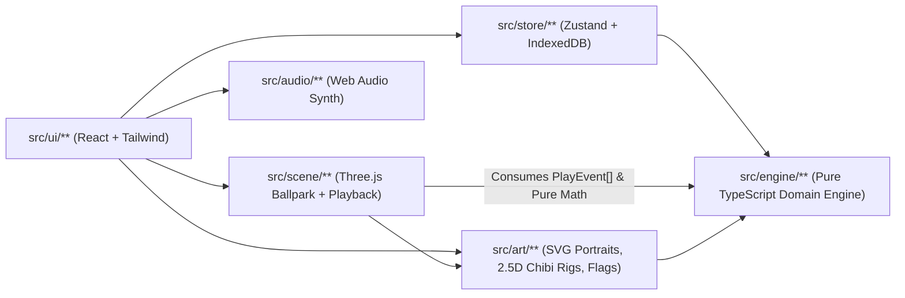

# Mini Baseball Manager — Canonical Architecture & Domain Contracts

> **Purpose**: Single source of truth for TypeScript interfaces, event streams, and storage schemas across `src/engine/`, `src/scene/`, `src/store/`, and `src/ui/`. Any AI agent building a new feature MUST align with these contracts so parallel slices integrate seamlessly.

---

## 1. Strict Dependency Direction



- **Rule**: `src/engine/**` NEVER imports from `src/ui/**`, `src/scene/**`, `src/store/**`, `src/audio/**`, or browser globals (`window`, `document`, `indexedDB`).
- **Rule**: `src/engine/**` only imports pure types/modules inside `src/engine/**` (exception: `BallVfxStyle` type-only import if kept pure; prefer defining `BallFlightStyle` inside `src/engine/models/` and re-exporting in `src/scene/vfx/`).

---

## 2. Core Domain Interfaces (`src/engine/models/`)

### Off the Clock

`getPlayerHobby` resolves each fixed identity to a clue and story. Featured players have authored assignments. The remaining players draw deterministically from the first-edition shared pool or a locally rooted activity. Personal clues and quotes in `playerHobbyStories.ts` are pinned to the player’s catalog ID. Individual illustrations are 560 × 700 WebP assets keyed by that ID. The album checks the saved hobby and quote against the illustrated story before displaying its print. Earlier quotes keep their signed postcards.

The club earns a conversation on its first recorded game and every second game thereafter. Unused conversations carry into future seasons through `priorHobbyGames`. A discovery adds a snapshot to `Club.hobbyMemories` and up to two morale to that roster member in one state transition. The album keeps the snapshot through trades, retirement and save imports. Missing fields on older saves default to an empty album and credit for the current season’s record.

### 2.1 Player & RPG Profile (`src/engine/models/player.ts`)

```ts
import type { PortraitTraits, CardRarity } from '../../art/portraits/types';
import type { BatsHand, FieldPosition, ThrowsHand } from '../handedness/types';
import type { NationalityId } from '../nationalities/types';

export type PersonalityArchetype =
  | 'prankster'
  | 'clutch_captain'
  | 'quiet_assassin'
  | 'showboat'
  | 'gym_rat'
  | 'superstitious'
  | 'rival_hunter';

export type FormState = 'blazing' | 'hot' | 'neutral' | 'cold' | 'frozen';

export type PlayerSpecialistArchetype =
  | 'balanced_regular'
  | 'contact_technician'   // High contact/eye hitter specialist, modest power/glove
  | 'power_slugger'        // Elite HR/RBI bat specialist, slower speed & weaker defense
  | 'defensive_wizard'     // Elite glove/arm/range specialist, lighter bat
  | 'speed_smallball'      // Blazing speed, bunt & steal specialist
  | 'super_utility'        // Multi-position glue specialist
  | 'flame_closer'         // High-velocity/K short-stamina relief specialist
  | 'crafty_tactician'     // Pinpoint control/movement pitcher specialist
  | 'southpaw_specialist'  // Situational matchup specialist
  | 'workhorse_ace';       // High-stamina starter

export type PositionalFlexibilityProfile =
  | 'single_position'      // e.g., strictly 1B-only or C-only
  | 'middle_infield_pair'  // SS + 2B only
  | 'corner_infield_pair'  // 1B + 3B only
  | 'infield_utility'      // Any infield spot (1B, 2B, 3B, SS)
  | 'corner_outfield_pair' // LF + RF only
  | 'all_outfield'         // LF + CF + RF
  | 'catcher_first'        // C + 1B
  | 'swingman_pitcher';    // SP + RP

export type PlayerMarketTier =
  | 'rookie'         // Young (18-21), cheap, high XP growth (1.35x), variable max statCaps
  | 'all_star'       // Rare, elite peak ratings + fan draw, very expensive contracts
  | 'veteran'        // Older (31-38), solid quality now at affordable pay, minimal growth (0.30x XP)
  | 'above_average'  // Strong reliable starter, starter-level pay, moderate upside
  | 'average'        // Fair-salaried everyday regular, balanced tools
  | 'below_average'; // League-minimum depth, often carries 1 sharp specialist tool

export type PitchType =
  | 'four_seam'    // 4-Seam Fastball (pure velocity, riding heat)
  | 'two_seam'     // 2-Seam / Sinker (arm-side tail, groundball heavy)
  | 'cutter'       // Cut Fastball (late glove-side bite, jams opposite-hand bats)
  | 'slider'       // Slider (sharp lateral sweep, two-strike chase weapon)
  | 'curveball'    // 12-6 / Knuckle-Curve (big vertical drop, speed change)
  | 'changeup'     // Circle Change (arm-speed deception, fades away)
  | 'splitter'     // Split-Finger / Forkball (late bottom-out drop)
  | 'knuckleball'; // Rare dancing flutterball (unpredictable break, lower velo)

export interface PitchSlot {
  pitchType: PitchType;
  mastery: number; // 1..99 per-pitch effectiveness & command feel
}

export interface PitcherArsenalProfile {
  // Strictly 2–3 pitches for Relievers ('RP'), 4–5 pitches for Starters ('SP')
  repertoire: PitchSlot[];
  favoritePitch: PitchType; // Highest-mastery "Out Pitch" (+6 Stuff, +4 Control; decays if spammed 3+ pitches in a row)
  weakestPitch: PitchType;  // Lowest-mastery "Show-Me Pitch" (-6 Stuff, -5 Control; trainable via Pitch Lab trade-offs)
}

export interface BatterPitchProfile {
  favoritePitch: PitchType; // Pitch they crush (e.g., Curveball Crusher, Dead-Red Fastball Hitter: +10..+16)
  weakPitch: PitchType;     // Pitch vulnerability (e.g., Slider Chase Hole, Changeup Timing Flaw: -10..-16)
  pitchRecognition: Partial<Record<PitchType, number>>; // -20..+20 per-pitch Contact/Power/Eye & chase modifier
}

export type MentalTraitId =
  | 'clubhouse_glue'    // Good clubhouse guy: lifts team morale recovery & chemistry, cushions losing streaks
  | 'high_energy'       // Sparkplug: accelerates Team Hype gain (+20%) and energizes rallies
  | 'ice_veins'         // Ice in their veins: sharp bonus in critical / high-Leverage Index moments
  | 'pressure_riser'    // Big-game performer: scales up Contact/Power/Control under playoff/rivalry stakes
  | 'pressure_wilt'     // Tightens up: loses Contact/Eye/Control/Stuff when Leverage Index is high
  | 'steady_hand'       // Even keel: resistant to slump spirals and pressure swings
  | 'fiery_competitor'; // Bulldog: extra edge in rivalry games & jams, higher fatigue burn

export type PressureResponseProfile =
  | 'ice_veins'
  | 'clutch_riser'
  | 'steady'
  | 'pressure_wilt';

export type PitcherRole =
  | 'starter'         // SP (4–5 pitches): high stamina, built for 5–7+ innings
  | 'long_reliever'   // RP (3 pitches): high-stamina bridge / mop-up / extra-inning reliever
  | 'short_reliever'  // RP (2–3 pitches): 1-inning middle-relief burst
  | 'loogy'           // RP (2–3 pitches, throws 'L'): Lefty One-Out Guy with amplified L-vs-L platoon break
  | 'setup_man'       // RP (2–3 pitches): 7th–8th inning high-leverage bridge
  | 'closer'          // RP (2–3 pitches): 9th+ inning save specialist (+Stuff/+CTL in save spots)
  | 'fireman';        // RP (2–3 pitches): multi-inning high-LI jam stopper deployed with runners on base!

export type GamePressureLevel =
  | 'regular'
  | 'series_rubber'
  | 'rivalry_showdown'
  | 'playoff_game'
  | 'elimination_championship';

export type BattedBallTendency =
  | 'groundball'
  | 'line_drive'
  | 'flyball'
  | 'balanced';

export interface BattedBallProfile {
  tendency: BattedBallTendency;
  gbRateBias: number;    // -12..+12 percentage-point shift on Ground Ball Rate (GB%)
  ldRateBias: number;    // -8..+8 percentage-point shift on Line Drive Rate (LD%)
  fbRateBias: number;    // -12..+12 percentage-point shift on Fly Ball Rate (FB%)
  popUpRateBias: number; // -8..+8 percentage-point shift on Pop-Up Rate (PopUp%)
}

export type CareerExperienceTier =
  | 'rookie_green'  // 0–14 expScore: 0 seasons / green rookie (-1..-2 high-LI jitters, offset by 1.35x skill growth)
  | 'developing'    // 15–39 expScore: 1–2 seasons / ~20–55 games (neutral composure)
  | 'seasoned'      // 40–69 expScore: 3–5 seasons / ~60–115 games (+1 Eye/Control, +1 high-LI composure)
  | 'cagey_veteran';// 70–100 expScore: 6+ seasons / 120+ games / 450+ PAs or 180+ IP (+2..+3 Eye/Control, +2 high-LI poise, -15% rust)

export interface CareerServiceProfile {
  seasonsPlayed: number;       // Legitimately earned season-by-season (veterans spawn with 6–12, rookies at 0)
  careerPlayoffGames: number;  // High-leverage postseason games logged
  experienceScore: number;     // 0..100 derived slowly from seasonsPlayed + careerGames + PAs/IP + playoffGames
  experienceTier: CareerExperienceTier;
}

export type GameLengthInnings = 5 | 7 | 9; // 5 = Sandlot Blitz (~2 min), 7 = Doubleheader (~4 min), 9 = Classic

export interface PitcherEnduranceEffect {
  enduranceRemaining: number; // 100 (fresh) .. 0 (gassed)
  tier: 'fresh' | 'solid' | 'tiring' | 'fatigued' | 'gassed';
  mphDrop: number;            // 0 .. -7 mph fastball/sinker/cutter radar drop
  breakDrop: number;          // 0 .. -15 drop in sinker sink, slider sweep, curve/splitter drop
  controlDrop: number;        // 0 .. -10 command fade / hanger risk
  gbRateShift: number;        // sinker/two-seam loses groundball sink when tired!
  scoutWarning?: string;      // e.g. "Sinker losing drop — Bullpen time!"
}

export interface PlayerRatings {
  // Batting (1–99) — drives AVG, OBP, SLG, OPS, BB%, K%
  contact: number;
  power: number;
  gapPower: number; // Extra-base 2B/3B drive power (SLG / OPS)
  eye: number;      // Plate discipline & Walk Rate (BB% / OBP)
  bunt: number;
  // Pitching (1–99) — drives Strike%, BB/9, K/9, WHIP, ERA
  velocity: number;
  movement: number;
  control: number;  // Strike-zone command (Strike% & Walk Rate)
  stamina: number;
  // Athleticism, Defense & Intangibles (1–99)
  speed: number;
  fielding: number; // Glove & hands -> Fielding Percentage (FPCT)
  range: number;    // Footwork & reaction -> converting line drives & grounders into outs
  arm: number;      // Arm strength -> gunning down runners & limiting extra bases
  clutch: number;   // High-leverage performance multiplier
  luck: number;     // Subtle universal edge (BABIP bloops, borderline calls, error bounces)
  popularity: number;
  potential: number;
}

export interface PlayerContract {
  salaryPerSeason: number;
  yearsRemaining: number;
  signingBonus: number;
  noTradeClause?: boolean;
}

export interface PlayerSeasonStats {
  games: number;
  plateAppearances?: number;
  atBats: number;
  hits: number;
  doubles: number;
  triples: number;
  homeRuns: number;
  rbis: number;
  walks: number;
  strikeouts: number;
  sacFlies?: number;
  stolenBases: number;
  // Batted-ball counts (for AVG/OBP/SLG/OPS/BABIP + GB%/LD%/FB%/PopUp%)
  groundBalls?: number;
  lineDrives?: number;
  flyBalls?: number;
  popUps?: number;
  // Pitching counts (for ERA, WHIP, K/9, BB/9, Strike%, GB%/LD%/PopUp%)
  inningsPitchedOuts: number; // stored in outs (e.g. 21 outs = 7.0 IP) to avoid float error
  hitsAllowed?: number;
  homeRunsAllowed?: number;
  earnedRuns: number;
  pitchingStrikeouts: number;
  pitchingWalks: number;
  pitchesThrown?: number;
  strikesThrown?: number;
  ballsThrown?: number;
  wins: number;
  losses: number;
  saves: number;
  holds?: number;
  // Fielding counts (for FPCT & Range Factor)
  putouts?: number;
  assists?: number;
  errors: number;
}

export interface Player {
  id: string;
  name: string;
  nickname: string;
  age: number;
  position: FieldPosition;
  secondaryPositions: FieldPosition[];
  bats: BatsHand;
  throws: ThrowsHand;
  jerseyNumber: number;
  nationalityId: NationalityId;
  hometown: string;
  personality: PersonalityArchetype;
  rarity: CardRarity;
  traits: PortraitTraits;
  bio: string;

  // RPG Progression
  level: number;
  xp: number;
  skillPoints: number;
  unlockedSkillIds: string[];
  equippedPowerIds: string[]; // max 2 (3 at Legend LV >= 12)
  equippedRelicIds: string[]; // max 2 90s Gear Relics
  heritageTierUnlocked: 0 | 1 | 2 | 3;

  // Live Status & Form
  marketTier: PlayerMarketTier;
  specialistArchetype: PlayerSpecialistArchetype;
  pitcherRole?: PitcherRole; // starter | long_reliever | short_reliever | loogy | setup_man | closer | fireman
  flexibilityProfile: PositionalFlexibilityProfile;
  favoritePosition: FieldPosition; // Playing favorite position awards +5 Fielding/+4 Control, +3 Clutch, +5 Morale
  positionProficiency: Partial<Record<FieldPosition, number>>; // 0..100; < 50 triggers Out-of-Position penalty
  pitchArsenal?: PitcherArsenalProfile; // Populated for SP (4–5 pitches) & RP (2–3 pitches)
  batterPitchProfile: BatterPitchProfile; // Favorite pitch to crush, pitch weakness & trainable recognition map
  battedBallProfile?: BattedBallProfile; // Drives GB% / LD% / FB% / PopUp% tendencies for batters & pitchers
  mentalTraits?: MentalTraitId[]; // Good clubhouse guy, high energy, ice veins, pressure riser/wilter, etc.
  pressureProfile?: PressureResponseProfile; // ice_veins | clutch_riser | steady | pressure_wilt
  careerService?: CareerServiceProfile; // Slow-earned seasons/games/ABs/IP experience granting veterans a subtle edge over rookies
  ratings: PlayerRatings;
  statCaps: PlayerRatings; // Per-tool max rating ceilings (1..99), widest variance on rookies
  totalRatingBudget: number; // Archetype + marketTier tool envelope preventing generic 99-all-stat overpowered clones (rare 'all_star' carries elite budget)
  xpGrowthMultiplier: number; // 1.35 (rookie) .. 0.30 (veteran)
  fatigue: number; // 0 (fresh) .. 100 (exhausted)
  morale: number; // 0 .. 100
  formScore: number; // -100 (frozen slump) .. +100 (blazing hot streak)
  formState: FormState;

  // Club & History
  contract: PlayerContract;
  formerClubIds: string[]; // enables poached-player Revenge Matchups!
  seasonStats: PlayerSeasonStats;
  careerStats: PlayerSeasonStats;
  awards: string[];
}
```

#### 2.1.1 Market Tiers, Pitch Arsenals, Compromise Training & Ability Scarcity Rules

| Market Tier | Age Band | Cost / Salary | XP Growth | Max `statCaps` / Upside | Strategic Role |
| :--- | :---: | :--- | :---: | :--- | :--- |
| **`rookie`** | 18–21 | Very cheap rookie deal | `1.35x` | **Wild variance** (boom-or-bust ceilings) | Draft & farm gems to develop |
| **`all_star`** | 24–29 | Rare & very expensive | `0.85x` | Peak 85–99 tools + popularity surge | Franchise centerpiece if affordable |
| **`veteran`** | 31–38 | Affordable short-term pay | `0.30x` | Minimal room to improve (at cap) | Plug-and-play quality + mentorship |
| **`above_average`** | 23–29 | Solid starter salary | `0.95x` | Good-to-strong 72–86 ceilings | Core everyday starters |
| **`average`** | 22–30 | Balanced middle pay | `0.85x` | 64–76 steady ceilings | Dependable rotation & lineup fillers |
| **`below_average`** | 20–32 | League minimum bargain | `0.75x` | Low overall floor, often **1 sharp specialist tool** | Late-inning glove, speed, or matchup role player |

- **Favorite Position & Out-of-Position Rules**: Deploying a player at `favoritePosition` grants **Favorite Position Boost** (`+5 Fielding` or `+4 Control` on mound, `+3 Clutch`, `+5 Morale`). Deploying them at a listed position with proficiency `>= 50` plays cleanly at normal rating. Deploying them below `50` or unlisted triggers Out-of-Position fielding/error penalties.
- **Cross-Training Trade-Off**: Training a new eligible position consumes a Practice turn (opportunity cost vs batting/pitching/slump drills), increases `positionProficiency[targetPos]` by `+12..+20`, and applies **`-4..-8` positional rust decay** to other secondary/current positions until sharpened again. Reaching `95+` mastery unlocks shifting `favoritePosition` to the newly mastered position.
- **Role-Locked Pitcher Arsenals (`2–3` RP vs `4–5` SP)**: Relievers (`RP`) carry strictly **`2` or `3` pitches** (high short-burst bite, faster second-time-through exposure); Starters (`SP`) carry strictly **`4` or `5` pitches** (at least one fastball + breaking/offspeed mix). Every pitcher has a **`favoritePitch`** (*Out Pitch*: `+6 Stuff / +4 Control`, with `-4` predictability decay per consecutive repeat past 2 in the same PA) and a **`weakestPitch`** (*Show-Me Pitch*: `-6 Stuff / -5 Control` hanger risk until trained).
- **Batter Pitch Affinities (`favoritePitch` & `weakPitch`)**: Every hitter rolls a **`favoritePitch` to face** (`+10..+16` recognition -> `+7..+11 Contact`, `+6..+10 Power`, sharper zone read) and a **`weakPitch`** (`-10..-16` recognition -> `+8..+12%` chase rate, `-8..-12 Contact`, higher whiff rate).
- **Universal Compromise-First Training (Zero Free God-Mode)**: Every training action involves a concrete trade-off bounded by `statCaps` and `totalRatingBudget` (so no ordinary player becomes overpowered across every tool, while rare, expensive `all_star` players retain genuinely high multi-tool ceilings):
  - *Power Launch Cage*: `+2..+4 Power`, **`-1..-2 Contact/Eye`** + `+12 Fatigue`.
  - *Contact Choke-Up Cage*: `+2..+3 Contact/Eye`, **`-1..-2 Power`** + `+10 Fatigue`.
  - *Batter Pitch-Recognition Drill*: `+4..+7` recognition on target pitch (mitigating `weakPitch` or boosting `favoritePitch` up to `+18`), **`-2..-4` timing drift on 1–2 neglected pitch types**.
  - *Bullpen Pitch Lab (Polish / Learn Pitch)*: `+4..+7` mastery on target pitch (can soften `weakestPitch` or shift `favoritePitch`), **`-2..-4` feel/command rust on neglected pitches** (and learning/replacing a pitch within the `2–3` RP / `4–5` SP slot limit temporarily taxes `-4..-6 Control` & `-3` mastery elsewhere).
  - *Velocity vs Pinpoint Conditioning*: Velocity training (`+2..+3 VEL`) trades `-1..-2 CTL` & `+16 Fatigue`; Command training (`+2..+4 CTL`) dials back `-1 VEL`.
  - *Position Cross-Training*: `+12..+20` target position mastery, **`-4..-8` positional rust** on other positions.
- **Limited-Use Special Abilities (Charges, Cooldowns & Hype Drain)**: Super-power swings, pitches, Cultural Heritage Tier-3 powers, and Manager powers are **scarce tactical finishers**, never constant every-PA spam:
  - *Batter Special Swings / Heritage Swings*: Max **`1` use per batter per game** (`2` only for Legend capstone), **`>= 2` PA team super-swing cooldown**, drains **`65–100` Team Hype**, and adds **`+8` Fatigue**.
  - *Pitcher Special Pitches / Heritage Pitches*: Max **`1` use per `RP` outing** and **`2` uses per `SP` outing**, **`>= 3` batters (`12` pitches) cooldown** between super-pitches, drains **`65–100` Team Hype**, and adds **`+8` arm Fatigue**.
  - *Manager Active Skipper Powers*: Max **`1` charge per power per game**.
- **Luck, Mental Traits, Pressure Risers vs. Wilters & Leverage Index (`LI`)**:
  - **`luck` (`1..99`)**: Subtle universal variance nudge (`±2.5%` BABIP bloop/hole hits, `±2%` borderline balls/strikes, error bounces, rare surprise events) — never overpowers real skill, just injects believable baseball fortune.
  - **Clubhouse & Mental Traits + Pressure Response**: Good Clubhouse Guys (`clubhouse_glue`) stabilize morale & chemistry; Sparkplugs (`high_energy`) accelerate Hype; **Ice-in-Veins / Pressure Risers** surge (`+4..+7`) when dynamic **Leverage Index (`LI`, `0.4` blowout → `1.6+` High Leverage → `2.4+` Critical Moment)** or game stakes (`rivalry_showdown`, `playoff_game`, `elimination_championship`) spike; **Pressure Wilters (`pressure_wilt`)** tighten up (`-4..-8`) in crunch time!
- **Specialized Pitching Staff Roles (`PitcherRole`)**: `starter`, `long_reliever`, `short_reliever`, `loogy` (southpaw platoon assassin), `setup_man` (7th–8th bridge), `closer` (9th+ save specialist), and `fireman` (high-LI multi-inning jam stopper with inherited runners).
- **Balls & Strikes, Batted-Ball Profiles & Sabermetrics**: Explicit ball/strike counts & zone strike rate (`Strike%`, `BB%`, `K%`), batted-ball profiles (`GB%`, `LD%`, `FB%`, `PopUp%`, `pop_out`), defender `fielding` (`FPCT`), `range` (converting hits to outs), and `arm` (runner throws), plus full derived stat lines (`AVG`, `OBP`, `SLG`, `OPS`, `ISO`, `BABIP`, `ERA`, `WHIP`, `K/9`, `BB/9`, `FPCT`).
- **Slow-Earned Career Experience & Veteran Savvy Advantage**: Career Experience (`CareerServiceProfile`: `seasonsPlayed`, `careerGames`, `careerPAs`/`IP`, `careerPlayoffGames` -> `experienceScore 0..100`) takes multiple full seasons of real games/at-bats to climb from `rookie_green` -> `developing` -> `seasoned` -> `cagey_veteran` (and RPG level XP thresholds scale slowly per level). Seasoned pros and veterans gain a small, realistic edge over green rookies (`+2..+3` Eye/Control, `+2` high-LI composure vs rookie jitters `-1..-2`, and reduced rust decay).
- **Pitcher Endurance & Pitch-Specific Fatigue Drop-Off**: Pitchers track live **`endurance` (`100` fresh → `0` gassed)** scaled by `ratings.stamina`, `pitcherRole`, high-leverage stress pitches (`LI >= 1.6`), and regulation inning length. As endurance falls below `60%` → `35%` → `20%`, pitch physics visibly degrade per pitch family: **`four_seam`/`two_seam`/`cutter`** lose radar-gun velocity (`-1..-7 mph`), **`two_seam` sinkers & `splitter`s** lose downward drop & `GB%` (flattening into line drives), and **`slider`/`curveball`** lose break & control (hanging meatballs). Between-game recovery makes rotation & bullpen management matter across a series.
- **Short-Burst & Long-Burst Game Pacing (Games Never Drag)**: Players choose **5-Inning Blitz**, **7-Inning Doubleheader**, or **9-Inning Classic** (scaling starter endurance proportionally), paired with **1x/2x/4x Live 3D**, **Sim At-Bat**, **Sim Half-Inning**, **Clutch-Moments Auto-Burst** (fast-sims routine frames and snaps into 3D only on `LI >= 1.55` / RISP / tired pitcher / Special Ready — ~2–4 min/game), **Instant Sim**, and **automatic Extra-Inning Ghost Runner on 2B** starting in the very first extra frame (`inning > regulationInnings`)!
- **Role-Specific Baseball Card Stats (`src/engine/models/playerCardStats.ts`)**: Collectible 90s baseball cards always show role-authentic stats on the back rather than one generic stat block:
  - **Pitchers (`SP` / `RP`)**: **Velocity**, **Movement**, **Control**, **Stamina**, **Clutch** + pitching stat line (`ERA`, `WHIP`, `K/9`, `Strike%`) and pitch arsenal summary — never batter Contact/Power bars.
  - **Batters & Fielders (`C`, `1B`, `2B`, `3B`, `SS`, `LF`, `CF`, `RF`)**: Classic 5 tools — **Contact**, **Power**, **Speed**, **Fielding**, **Arm** + batting/fielding stat line (`AVG`, `OBP`, `OPS`, `FPCT`) — never a Pitching bar.
- **Fair Starting Roster Presets (`StartingRosterPreset`, `TASK-064`)**:
  - Choosing `all_rookies | balanced | veterans | good_defense | good_hitting | good_pitching` in Club Creator shapes your club's starting age, market tiers, and tool strengths while keeping every preset inside the **exact same Rookie Sandlot OVR parity band** (`±1.5` avg OVR vs competing Rookie AI clubs) so winning the top-tier **Mini Major League World Championship** is always earned through multi-season development and GM craft:
    - `all_rookies`: 100% `rookie` prospects (`1.35x` XP, lowest payroll, high long-term ceiling, early rookie jitters).
    - `balanced`: Classic mix of rookies, average starters, and seasoned leaders.
    - `veterans`: Cagey older core (`veteran`/`seasoned` composure & command edge early, minimal `0.30x` growth, looming retirements).
    - `good_defense`: Boosted `fielding`/`range`/`arm` & glove specialists, offset by lighter power bats.
    - `good_hitting`: Boosted `contact`/`power`/`gapPower` bats, offset by work-in-progress pitching & average defense.
    - `good_pitching`: Boosted `velocity`/`movement`/`control` staff, offset by scrappy small-ball offense.
- **Full End-of-Season & Offseason Cycle + Tier Salary Caps (`TASK-065`)**:
  - **Tier-Scaled Payroll Salary Caps**: `rookie: $12,000`, `low_a: $18,000`, `high_a: $26,000`, `aa: $38,000`, `aaa: $54,000`, `majors: $80,000` annual club payroll limits enforced across Re-Signings, Free Agency, and Draft signings alongside `MAX_ACTIVE_ROSTER_SIZE = 20`.
  - **Structured 5-Stage Offseason Pipeline**:
    1. **Playoffs, Awards & Promotion/Relegation** (World Champions crowned in Mini Major League!).
    2. **Player Retirements** (age/decline-based retirements clearing roster slots & cap space, with retiring club legends eligible for HOF/Coach transition).
    3. **Expiring Contracts & Re-Signing Window** (`yearsRemaining - 1`; players at `0` enter expiring queue where human & AI clubs offer extensions under Salary Cap or let them hit Free Agency).
    4. **3-Round Amateur Draft** (reverse-standings draft order replenishing youth talent on cheap rookie deals).
    5. **Offseason Free-Agent Signing Window** (open market populated by league expiring players + fresh FA pool; AI & human fill rosters under the `20`-man cap and Tier Salary Cap before Opening Day).
- **Asymmetric Co-Ed Attribute Tilts, Complementary Special Traits & Roster-Mix Synergies (`TASK-066`)**:
  - Built directly on each player's `traits.presentation` (`'male' | 'female'`) with **zero average OVR advantage** for either sex—instead delivering playful, classic 90s arcade-baseball complementary strengths, weaknesses, and special traits so every roster composition is strategically meaningful:
    - **Male Athlete Tilt & Signature Traits**: Stronger raw **Power (`+6`)**, **Velocity (`+6`)**, and **Arm (`+4`)**, balanced by looser **Eye (`-4`)**, **Contact (`-4`)**, **Control (`-4`)**, and **Fielding/Range (`-3`)**. Unlocks male-signature traits: **`thunder_bravado`** (HR/K triggers `+10` Hype adrenaline surge & rattles opposing control, with `+4%` chase risk behind in counts), **`cleanup_enforcer`** (protects the preceding batter with `+4 Eye` and adds `+3 Power` with RISP), and **`iron_shoulder`** (`-10%` fastball endurance drain).
    - **Female Athlete Tilt & Signature Traits**: Stronger **Contact (`+5`)**, **Eye (`+5`)**, **Movement (`+5`)**, **Control (`+5`)**, **Fielding/Range (`+4`)**, **Speed (`+4`)**, plus a small, noticeable **`+6` starting Popularity** fan-appeal boost that draws a modest **`+1–6%`** extra ballpark attendance (never unbalanced), balanced by lighter raw **Power (`-5`)**, **Velocity (`-5`)**, and **Arm (`-3`)**. Unlocks female-signature traits: **`tactical_poise`** (cuts team cold-slump drag by `30%`, reduces team errors by `15%`, and adds `+3 Eye/+3 Control` at `LI >= 1.55`), **`precision_spark`** (grants the next batter/teammate `+4 Contact/+3 Power` table-setter boost), and **`crafty_spin_wizard`** (`+5 Movement` on breaking/offspeed pitches and `-25%` fatigue break drop).
    - **Clubhouse Roster-Mix Synergies (`evaluateCoEdClubhouseSynergy`)**:
      - **Balanced Co-Ed (`>= 30%` each)**: *Total Baseball Harmony* — pairs table-setter OBP/defense/poise with cleanup HR/velo thunder.
      - **Mostly Male + Key Female Splash (`1–3` female players)**: *Calm in the Storm* — injects command, poise & slump stabilization into a volatile slugger core.
      - **Mostly Female + Key Male Splash (`1–3` male players)**: *Thunder Anchor* — injects middle-of-the-order HR threat & triple-digit gas into a precision small-ball machine.
      - **All-Male (`100%` male)**: *Bash-Bro Chaos* — extreme HR/velo & hype bursts (`+3 Power/+3 Velocity` identity), intentionally missing composure/discipline/glove consistency (`-3 Eye/-3 Control`).
      - **All-Female (`100%` female)**: *Precision Swarm* — relentless contact, spin, speed & iron defense (`+3 Contact/+3 Movement/+3 Fielding` identity), intentionally missing easy HR/100-mph thunder (`-3 Power/-3 Velocity`).
- **Full Realistic Multi-Season Career Arc (`TASK-041`)**:
  - Every player follows a genuine baseball aging trajectory across seasons:
    - **Rookie & Development (`18–24`)**: Ratings grow briskly toward `statCaps` (`1.05x–1.35x` XP & offseason skill jumps), building raw physical tools while still green in `CareerServiceProfile`.
    - **Prime Peak (`25–30`)**: Physical tools peak near ceilings while `seasoned` savvy kicks in.
    - **Crafty Veteran (`31–34`)**: Raw speed/velocity hold or tick down gently (`-0..-1/yr`), offset by peak `cagey_veteran` Eye/Control/high-LI composure and rookie mentorship aura.
    - **Late-Career Decline (`35+`)**: Physical ratings gradually diminish each offseason (`Speed`, `Velocity`, `Range`, `Stamina`, `Power` drop `-1..-4/yr` based on age & durability) while `Eye`, `Control`, and `Clutch` fade much more slowly — creating authentic GM trade-offs on when to re-sign, transition to DH/RP, or watch them retire (eligible for Club HOF & hireable Coach pool!).
- **Toggleable Athletic Injuries & Illnesses Engine (`TASK-067`)**:
  - **New-Game Settings Toggles**: Independent `enableInjuries: boolean` and `enableIllnesses: boolean` switches in Club Creator (`UserSaveSettings`) so players can disable either or both at game start.
  - **Low-Frequency, Fun-First Tuning**: Base occurrence probabilities are intentionally low so players are **not** constantly hurt or sick; health events add occasional realistic roster storylines and bullpen/bench depth tests without ruining the arcade fun.
  - **Content Guardrails & Sex-Specific Support**: **Zero fatalities / deaths** and **zero STDs**; extensible declarative catalog (`src/engine/health/conditionsCatalog.ts`) supports `applicableTo: 'all' | 'male' | 'female'` (matched to `traits.playerLook`) and 4 rarity tiers (`common`, `uncommon`, `rare`, `ultra_rare`) so new rare injuries/illnesses can be added effortlessly.
  - **Play-Through vs. Mandatory IL & Duration Tiers**:
    - `canPlayThrough: true` (e.g., leg cramp, blister, jammed finger, mild cold, seasonal allergies, yeast infection, mild migraine): playable with condition-specific stat reductions (e.g. leg cramp `-12 Speed / -8 Range`, yeast infection `-5 Stamina / -4 Focus`) + slightly slower healing, or rest to recover faster.
    - `canPlayThrough: false` (e.g., broken arm, fractured wrist, concussion, UCL tear, ACL tear, appendicitis, pneumonia, mononucleosis, ultra-rare early-detected breast/testicular cancer treatment & full comeback recovery): forces player onto the **Injured List (IL)** — impossible to play through!
    - Severity bands: `day_to_day` (`1–2` games), `short_il` (`3–6` games), `long_il` (`7–14` games), `season_ending` (rest of season), and rare `career_ending_risk` (primarily weighted to aged veterans `34+` suffering catastrophic tears).
- **Hireable Specialty Team Doctors & Head Athletic Trainers (`TASK-068`)**:
  - **Team Doctor (`TeamDoctor`, Quality Tier `1–5`)**: Higher-budget MDs accelerate recovery (`-15%..-55%` healing time on specialty matches), cut relapse/aggravation risk, and help prevent illness outbreaks. Specialties: `orthopedic_arm` (elbow/shoulder/wrist), `orthopedic_legs` (hamstring/ankle/knee/groin), `concussion_neuro` (concussions/migraines), `internal_medicine` (flu/mono/pneumonia/GI), `womens_sports_medicine` (female-specific prevention & care), and `oncology_complex_care` (rare/ultra-rare recovery & veteran comeback).
  - **Head Athletic Trainer (`AthleticTrainer`, Quality Tier `1–5`)**: Higher-budget trainers actively prevent injuries/illnesses before they happen and preserve long-term career durability! Specialties: `arm_care_velo` (pitcher arm health & endurance), `soft_tissue_mobility` (cramps/strains/hamstrings), `strength_durability` (smaller play-through penalties & slower `35+` aging decline), `recovery_nutrition` (faster fatigue recovery & immune boost), and `rehab_conditioning` (protects ratings after long IL stints).

### 2.2 Club, Lineup & Stadium District (`src/engine/models/club.ts`)

```ts
export type LeagueTierId = 'rookie' | 'low_a' | 'high_a' | 'aa' | 'aaa' | 'majors';

export type AiArchetype =
  | 'mashers'
  | 'speed_demons'
  | 'ace_factory'
  | 'defense_first'
  | 'moneyball';

export interface LineupSlot {
  orderIndex: number; // 0..8
  playerId: string;
  defensivePosition: Exclude<FieldPosition, 'SP' | 'RP'> | 'DH';
}

export interface ClubColors {
  primary: string;
  secondary: string;
  accent: string;
  monogram: string;
}

export interface DistrictTile {
  slotId: string; // e.g., 'north-1', 'east-2'
  buildingId: string | null; // e.g., 'nacho_cantina', 'pitching_lab', 'bobblehead_shop'
  tier: 1 | 2 | 3;
}

export type BallparkPresetId =
  | 'sandlot_commons'
  | 'brickyard_classic'
  | 'bayfront_cove'
  | 'high_altitude_mesa'
  | 'neon_metro_dome'
  | 'cornfield_twilight'
  | 'harbor_shipyard'
  | 'sakura_garden'
  | 'sunbelt_cactus'
  | 'grand_cathedral';

export interface ParkFactors {
  leftWallFt: number;
  centerWallFt: number;
  rightWallFt: number;
  leftWallHeightFt: number; // e.g., tall Emerald Wall in Brickyard Classic
  surface: 'natural_grass' | 'fast_turf';
  isDome: boolean;
  hrFactor: number; // 0.85..1.20
  leftyHrFactor: number; // e.g., Harbor Shipyard short RF porch boosts LHB HRs
  rightyHrFactor: number;
  doublesTriplesFactor: number; // 0.90..1.18
  groundballSpeedFactor: number; // fast_turf boosts grounders & speed
}

export interface StadiumState {
  ballparkId: BallparkPresetId;
  name: string;
  seatingTier: 1 | 2 | 3 | 4; // Bleachers -> Grandstand -> Double-Deck -> Mega Dome
  capacity: number;
  hasJumbotron: boolean;
  hasNightLights: boolean;
  hasMascotCannon: boolean;
  themeId: string;
  retiredNumbers: { jerseyNumber: number; playerName: string }[];
  championshipPennants: { season: number; leagueTier: LeagueTierId }[];
  districtTiles: DistrictTile[];
}

export type StaffRole =
  | 'pitching_coach'
  | 'hitting_coach'
  | 'bench_coach'
  | 'fielding_coach'
  | 'bullpen_coach'     // Helps BOTH catchers (framing, pop-time, calling) & pitchers (warmup, endurance, reliever poise)
  | 'equipment_manager' // Boosts 90s Gear/Relics, bat/glove/cleat tuning, blister prevention, morale & vintage gear finds
  | 'team_doctor'
  | 'athletic_trainer';

export const STAFF_SLOT_LIMITS_BY_TIER: Record<LeagueTierId, number> = {
  rookie: 2,
  low_a: 3,
  high_a: 4,
  aa: 5,
  aaa: 6,
  majors: 7,
};

export interface StaffMember {
  id: string;
  role: StaffRole;
  firstName: string;
  lastName: string;
  portraitSeed: number;
  tier: 1 | 2 | 3 | 4 | 5;     // Hiring quality tier (drives salary & cap ceiling)
  level: 1 | 2 | 3 | 4 | 5;    // Developed over seasons via Staff XP & Offseason Clinics
  xp: number;
  salaryPerSeason: number;
  yearsRemaining: number;
  specialtyId: string;          // e.g., 'gas_lab', 'launch_guru', 'battery_whisperer', 'relic_tuner', 'orthopedic_arm'
  tradeOffSummary: string;      // Explicit compromise cost (no free-lunch all-99 coach!)
  formerPlayerId?: string;      // Populated when a retiring club legend transitions to coach!
}

export interface CoachStaffState {
  activeStaff: StaffMember[];   // Capped at STAFF_SLOT_LIMITS_BY_TIER[club.leagueTier] & club budget
  clinicSessionsUsedThisOffseason: number;
}

export interface ClubEconomy {
  cash: number;
  fanBase: number;
  teamHype: number; // 0..100
  ticketPrice: number;
  concessionPrice: number;
  concessionQuality: 1 | 2 | 3;
  scoutingBudget: number;
  tvContractId: string | null;
  activeSponsorIds: string[];
}

export const MAX_ACTIVE_ROSTER_SIZE = 20; // Hard cap for draft/FA signings & trades (clubs start at 18)
export const MIN_ACTIVE_ROSTER_SIZE = 15;
export const MAX_ACADEMY_ROSTER_SIZE = 6;

export interface Club {
  id: string;
  isHuman: boolean;
  city: string;
  name: string;
  mascot: string;
  colors: ClubColors;
  leagueTier: LeagueTierId;
  aiArchetype: AiArchetype;
  roster: Player[];
  academyProspects: Player[]; // up to 6 youth farm players
  lineup: LineupSlot[]; // 9 slots
  rotationIds: string[]; // 3–5 starting pitchers
  bullpenIds: string[];
  rotationCursor: number;
  coaches: CoachStaffState;
  stadium: StadiumState;
  economy: ClubEconomy;
  wins: number;
  losses: number;
  streak: number; // +N win streak, -N losing streak
}
```

#### Coaching Staff, Equipment Manager & Multiple Stadiums Rules (`TASK-035`, `TASK-069`)

- **Full Dugout & Clubhouse Staff Roles (`TASK-035`)**:
  - **Pitching Coach**: Boosts pitcher training drills (`velocity`/`movement`/`control`), Pitch Lab mastery, and limits mound meltdowns. Philosophy trade-offs split archetypes (*Gas Lab* `+Velo/+K` vs higher endurance drain; *Groundball Professor* `+Sinker/+GB%/+Control` vs softer velo; *Command Tactician* `+Control/-BB` vs fewer strikeouts).
  - **Hitting Coach**: Boosts batting drills (`contact`/`power`/`eye`), Pitch Recognition, and slump busting. Trade-offs split archetypes (*Launch-Angle Guru* `+Power/+HR` vs slightly higher K-rate; *Small-Ball Craftsman* `+Contact/+Eye/+Bunt` vs capped power gains; *Clutch Mentor* `+LI hitting` vs slower raw tool growth).
  - **Bench Coach**: Tactical right-hand skipper boosting in-game tactical call accuracy, pinch-hit/pinch-run & platoon matchup IQ, defensive shift effectiveness, Manager Power efficiency, and clubhouse morale cohesion (*Hard-Nosed Tactician* vs *Players' Skipper* trade-offs).
  - **Fielding Coach**: Sharpens `fielding`, `range`, `arm`, double-play turns, error reduction, and accelerates **Positional Cross-Training** while cutting positional rust penalties (*Range Specialist* vs *Sure-Handed Fundamentalist*).
  - **Bullpen Coach (Catchers + Pitchers)**: Bridges the battery — speeds reliever warmup readiness, slows reliever fatigue buildup, boosts catcher pitch-framing (extra borderline strikes), catcher pitch-calling synergy (`Battery Telepathy`), pop-time/throwing out base-stealers, and passed-ball/wild-pitch suppression!
  - **Equipment Manager**: Charming clubhouse specialist who amplifies **90s Gear & Relics** (`+15%..+35%` relic bonuses or extra relic slot tuning), provides subtle bat/glove/cleat upkeep perks (fresh pine tar/rosin in wet weather, traction & barrel feel), cuts blister/equipment-irritation risk, lifts team morale, and has a small per-series chance to uncover quirky vintage 90s gear/relics or discount merch!
  - **Strategic Limits & Staff Development**:
    - **Hard Tier-Scaled Staff Slot Cap (`STAFF_SLOT_LIMITS_BY_TIER`)**: Starts at just **`2` active staff slots** in Rookie Ball (`Low-A: 3`, `High-A: 4`, `AA: 5`, `AAA: 6`, `Majors: 7`) shared across Coaches, Equipment Manager, Team Doctor, and Athletic Trainer — making every hire a genuine GM trade-off (*e.g., Hitting + Bullpen Coach vs. Pitching Coach + Team Doctor vs. Fielding Coach + Equipment Manager*).
    - **Staff Budget & Philosophy Trade-Offs**: Higher-tier (`1–5`) staff cost substantially more club cash per season, and every specialty comes with a real baseball philosophy compromise.
    - **Ways to Develop Staff**: Active staff earn **Staff XP** from games, series wins, playoffs, and player breakouts to climb `Lv 1 → Lv 5`; clubs can also spend cash on **Offseason Coaching Clinics / Seminars** (capped per offseason) or hire/develop **Retiring Club Legends (`TASK-041`)** — though leveled-up coaches demand fair raises at contract renewal or risk being poached by higher-tier clubs!
- **Multiple Distinct Stadiums, Sandlot-to-Pro Major League Progression & Park Factors (`TASK-033`, `TASK-069`)**:
  - **6-Tier League Capacity & Full Look-and-Feel Ladder**: Higher leagues progressively scale both **fan capacity** and **full 3D stadium architecture & atmosphere**:
    - `rookie` (*Neighborhood Sandlot*, `500–1,500` capacity): Chain-link outfield fence, simple wooden park benches, backyard pine trees, hand-painted manual wood scoreboard, daytime-only sky, cozy sandlot crowd.
    - `low_a` (*Small-Town Community Park*, `2,200–3,800`): Covered timber home grandstand, 1B/3B bleachers, painted local wall ads, wooden press box, starter light poles.
    - `high_a` (*Municipal Single-A Stadium*, `4,500–7,000`): Concrete & brick lower-bowl stands wrapping down the foul lines, bullpens, LED line-score board, 4 stadium floodlight towers, sponsor billboards.
    - `aa` (*Double-A Regional Ballpark*, `8,000–12,500`): Expanded concourse roof overhang, outfield pavilion seating, club press suites, rising neighborhood district skyline, booming crowd.
    - `aaa` (*Triple-A Pro Showcase Park*, `14,000–20,000`): Full wraparound lower deck + upper balcony grandstands, towering center-field Jumbotron, suite ribbon, multi-bank pro floodlights, packed roaring stands.
    - `majors` (*Pro Major League Cathedral / Mega Dome*, `28,000–45,000`): Monumental multi-deck pro Major League bowl (upper decks, luxury suites, outfield pavilion, optional dome trusses), giant HD Jumbotron & ribbon boards, mascot cannon & fireworks towers, retired-number wall plaques, championship pennants & thunderous sellout stadium wave!
  - **10 Distinct Handcrafted Ballparks & Live Park Factors**: `10` handcrafted 90s-inspired ballparks (`sandlot_commons`, `brickyard_classic`, `bayfront_cove`, `high_altitude_mesa`, `neon_metro_dome`, `cornfield_twilight`, `harbor_shipyard`, `sakura_garden`, `sunbelt_cactus`, `grand_cathedral`) are assigned across the 48 clubs in the 6-tier pyramid so road trips feel genuinely different in both **simulation math** and **3D visuals**.
  - **Live Simulation Park Factors**: `pitchResolver.ts` and `ballTrajectory.ts` apply the host venue's `ParkFactors` (short RF porches favoring lefty pull HRs, tall left-field walls turning HRs into doubles, thin mountain air carrying fly balls, indoor domes eliminating rain/wind while fast turf speeds up groundballs).
  - **Promotion Scaling, Home Upgrades & Relocation**: Clubs start at **Rookie Sandlot** scale (`~1,200` capacity) and grow organically as they climb tiers (promotions raise baseline capacity & unlock bigger stadium seating tiers/venues) AND through Sim-City seating/facility upgrades (`seatingTier 1 → 4`, Jumbotron, Floodlights, Mascot Cannon) or commissioning a new higher-tier Stadium Archetype!
- **Speed-Driven Base Stealing, Catcher Throw-Outs & AI Baserunning (`TASK-070`)**:
  - **Supported Steal Plays**: `steal_2b` (1B → 2B when 2B open), `steal_3b` (2B → 3B when 3B open), `double_steal` (1B + 2B → 2B + 3B when 3B open), and high-risk `steal_home` (3B → Home for elite speedsters / 2-out gambles), countered defensively by `pitchout` / `hold_runner` calls.
  - **Speed-Driven Success Formula (`src/engine/simulation/baserunning.ts`)**: Runner **`ratings.speed`** is the primary driver (smooth nonlinear curve from sluggish ~18–28% at `30 SPD` to elite ~80–89% at `90+ SPD` on 2B), modified by `speed_smallball` jump bonus, hot/cold form, runner fatigue & leg injuries, cleats relics, target-base difficulty (`2B` baseline, `3B` `-8%`, `Double Steal` lead runner `-5%`, `Home` `-42%`), catcher **`arm` + `fielding`**, Bullpen Coach `catcherPopTimeBonus`, LHP `pickoffHoldBonus` (strongest at 1B), pitcher fatigue/off-speed pitch bonus, and defensive `pitchout` penalty (`-32%`).
  - **Stats, AI & Live HUD**: Track both **`stolenBases` (`SB`)** and **`caughtStealing` (`CS`)** (deriving `SB% = SB / (SB + CS)`) on box scores, `PlayerSeasonStats`, and league leaders; enable smart **AI base-stealing decisions** in simmed/AI half-innings (weighted by runner `speed`, AI archetype such as `speed_demons`, outs, score/LI, and estimated success odds `>= 62%`); render live **Steal Odds %** pills & target selectors in the Game Day HUD!
- **4-Slot Auto-Save Persistence, Upbeat Guide & Playable Manager Backstories (`TASK-071`, `TASK-072`, `TASK-073`)**:
  - **4-Slot Auto-Save & Resume (`TASK-071`)**: `SaveSlotId = 'slot-1' | 'slot-2' | 'slot-3' | 'slot-4'` storing `activeSlotId`, club crest, tier, W-L record, `backstoryId`, and `updatedAtIso`; auto-saves transparently on every game completion, front-office action, stadium upgrade, or story decision, auto-resumes the last active slot on startup, and provides a 2-step **Delete Saved Game** flow to clear any slot and start over cleanly.
  - **Upbeat Illustrated Dugout Handbook (`TASK-072`)**: Comic-styled, skimmable guide chapters hosted by **Coach Pops** (*Sandlot-to-Majors Climb*, *Game Day Chess & Stealing*, *Roster/Staff/Co-Ed Craft*, *Ballpark Tycoon & World Spectacles*) available anytime in the header plus an optional Opening Day welcome tour.
  - **Manager Backstories & Choose-Your-Own-Adventure Story Engine (`TASK-073`)**:
    - `ManagerBackstoryId`: `'sandlot_hero' | 'ex_pro_comeback' | 'spreadsheet_prodigy' | 'showbiz_promoter' | 'world_ball_scout' | 'surprise_inheritor'`.
    - Each backstory applies both **Opening Day Starting Modifiers** (cash, fanbase, hype, manager level/SP, scouting reveal, starter relic/staff, or instant rivalry heat) AND **Ongoing Career Passives & Trade-Offs** (XP curves, promo/merch multipliers, FA discounts, Winter Ball stipends, Heritage charge speed, media/board pressure).
    - **Branching Story Arcs (`StoryEngine`)**: Tracks `storyState: { backstoryId, completedChapterIds, storyFlags, pendingChapterId, historyLog }` inside the save file; career triggers (Opening Day, First Rivalry, First Promotion, Mid-Season Crisis, Playoff Push, Majors Debut, World Series) surface comic Choose-Your-Own-Adventure chapters whose choices set permanent `storyFlags`, modify club/roster/rivalry state, and alter downstream chapters and *Sandlot Gazette* headlines!

### 2.3 Simulation Event Stream Contract (`src/engine/models/playEvent.ts`)

The simulation engine (`src/engine/simulation/`) emits pure `PlayEvent` objects. The 3D Scene Playback Controller (`src/scene/playback/`) consumes them to animate pitches, swings, all 9 fielders, baserunners, VFX, comic callouts, and audio cues!

```ts
export type PlayEventType =
  | 'game_start'
  | 'inning_start'
  | 'at_bat_start'
  | 'manager_power_used'
  | 'pitch_thrown'
  | 'ball_in_play'
  | 'stolen_base_attempt'
  | 'pitching_change'
  | 'inning_end'
  | 'game_end';

export type AtBatOutcome =
  | 'ball'
  | 'called_strike'
  | 'swinging_strike'
  | 'foul'
  | 'walk'
  | 'strikeout'
  | 'single'
  | 'double'
  | 'triple'
  | 'home_run'
  | 'ground_out'
  | 'fly_out'
  | 'line_out'
  | 'double_play'
  | 'sac_fly'
  | 'fielding_error'
  | 'bunt_single'
  | 'bunt_out';

export interface PlayEvent {
  seq: number;
  type: PlayEventType;
  inning: number;
  half: 'TOP' | 'BOT';
  outsBefore: number;
  outsAfter: number;
  balls: number;
  strikes: number;
  awayScore: number;
  homeScore: number;
  basesAfter: [string | null, string | null, string | null]; // 1B, 2B, 3B runner IDs
  batterId?: string;
  pitcherId?: string;
  outcome?: AtBatOutcome;
  isClutchMoment: boolean; // Triggers Clutch Cam zoom-in!
  isRivalrySpark?: boolean;
  specialPowerTriggered?: {
    actor: 'pitcher' | 'batter' | 'fielder' | 'manager';
    powerId: string;
    calloutText: string;
    vfxColor: string;
  };
  ballFlight?: {
    style: BallVfxStyle;
    landingX: number;
    landingZ: number;
    apexY: number;
    durationSec: number;
  };
  fieldingHighlight?: {
    fielderId: string;
    fielderPos: FieldPosition;
    anim: 'field_run' | 'field_dive' | 'field_high_jump';
  };
  pitchThrown?: {
    pitchType: PitchType;
    mph: number;
    isFavoritePitch: boolean;
    isWeakPitchForPitcher: boolean;
    batterAffinity: 'favorite' | 'weak' | 'neutral';
  };
  commentary: string;
  soundCue?: SoundCue;
  xpAwards?: { playerId: string; xp: number }[];
}
```

The optional `Club.keepsakes` collection travels with each career slot and portable save. Each entry retains a stable game/event key, credited player ID and name, opponent, inning, half, play and score at the time. The full event log feeds the selector even when the manager enters mid-game or fast-forwards. The shorter live ticker remains a presentation history.

The Opening Day card previews the same seeded clutch session passed to live playback. The scoreboard holds the preceding game state until the choreographed decision. The field call, scoreboard and runner highlight all use the selected play event. Postgame headlines use that game's player stat deltas.

### 2.4 Local Persistence Schema (`src/store/persistence.ts`)

```ts
export const CURRENT_SAVE_SCHEMA_VERSION = 1;

export interface SaveSlotMetadata {
  slotId: 'slot-1' | 'slot-2' | 'slot-3';
  clubName: string;
  leagueTier: LeagueTierId;
  seasonNumber: number;
  recordLabel: string; // e.g., "14-7"
  updatedAtIso: string;
  schemaVersion: number;
}

export interface SaveFileV1 {
  schemaVersion: 1;
  savedAtIso: string;
  worldSeed: number;
  seasonNumber: number;
  currentSeriesIndex: number;
  humanClubId: string;
  manager: ManagerProfile;
  leagues: Record<LeagueTierId, Club[]>;
  rivalries: RivalryRecord[];
  trophies: TrophyRecord[];
  newspaperArchive: NewspaperIssue[];
  unlockedCosmeticIds: string[];
  settings: {
    muted: boolean;
    volume: number;
    defaultGameSpeed: 1 | 2 | 4;
    defaultWatchMode: 'live' | 'clutch' | 'sim';
    reducedMotion: boolean;
    hapticsEnabled: boolean;
  };
}
```

---

## 3. 3D World Coordinate Reference (`src/scene/`)

| Landmark | World `(x, y, z)` | Notes |
| :--- | :--- | :--- |
| Home Plate | `(0, 0, 0)` | Catcher at `(0, 0.04, 1.75)` facing `-Z` |
| Right-Handed Batter's Box | `(-0.95, 0.04, 0.15)` | 3rd-base side (`-X`) |
| Left-Handed Batter's Box | `(+0.95, 0.04, 0.15)` | 1st-base side (`+X`) |
| Pitcher's Mound | `(0, 0.24, -10.2)` | Pitcher faces `+Z` (`logicalYaw = 0`) |
| 1st Base | `(+9.8, 0, -9.8)` | 1B defender near `(8.8, 0.04, -11.4)` |
| 2nd Base | `(0, 0, -19.6)` | 2B `(4.6, 0.04, -17.6)`, SS `(-4.6, 0.04, -17.6)` |
| 3rd Base | `(-9.8, 0, -9.8)` | 3B defender near `(-8.8, 0.04, -11.4)` |
| Outfielders | `LF (-15, 0.04, -27)`, `CF (0, 0.04, -32)`, `RF (+15, 0.04, -27)` | Facing `+Z` toward home plate |
| Outfield Wall Arc | Radius `40` centered at `(0, 0, -3)` | Scoreboard at `(0, 7.6, -44.2)` |
| Behind-Home Grandstand | `z = 9.2..15.2` | Visible behind catcher in Pitcher OTS 3D |

### Live replay and batter handoff

Game Day advances the simulation once per manager action. It keeps the pre-play session and the chosen event alongside the choreography. Replaying starts a new presentation clock for that event. The scorebook, player totals and career rewards are written only by the original simulation action. Opening Day guidance is scoped to the starting inning and half. A third out or walk-off can finish its field sequence before the manager changes sides or opens the final box score.

The featured-player cue identifies the batting or pitching role. A handoff after a batting out carries the outgoing batter’s ID so the scene can dress the second rig from the same roster. Replay scoring text requires the recorded fielding position and the animated throw to agree. The between-innings pack button opens the existing welcome pack in inventory.

Game Day stays mounted in a career-keyed React Activity during a visit to another tab. Hiding the game suspends timers and disposes the WebGL scene. Returning restores the same session, selected call and replay handoff. The selected pitch target travels with the recorded close play so a replay can reproduce the catcher’s setup.

A managed single can stage a decision while its runner rounds third. The live session and game log advance only when the manager chooses. Both calls use the same pre-pitch session and isolated pitch inputs. The recorded third-base result drives runner advances, fielding credits, camera cuts and the scoring call.

Players retain up to six fair-contact locations. Older careers start recording locations on their next game. The out-of-town final belongs to the scheduled series and game, and its two clubs receive their record and stat updates once.

### 3-Mode Pitching Controls (`PitchingMode`)

Pitching controls are persisted independently of Pro dugout panels in `useUserPreferencesStore.pitchingMode` (`'simple' | 'normal' | 'advanced'`, defaulting to `'simple'` including Opening Day guided mode). In `'simple'`, `src/engine/simulation/catcherCalls.ts` deterministically generates a 2–3 sign sequence (`Over Plate`, `Corner`, `Low Chase`, or fastball-only `High Heat`) that the player can accept or cycle via Shake Off while `resolveIsolatedStepInputs` guarantees exact 1:1 execution; in `'normal'`, the player selects `Over Plate`, `Corner`, or `Low Chase` while `selectPitchForCount` selects a location-matched pitch automatically; in `'advanced'`, the player selects both location and pitch type from the active pitcher's arsenal.
